# Figures and selected case studies

[Results overview](../results/README.md)

## PointPillars benchmark and diagnostics

### pointpillars distance diagnostic

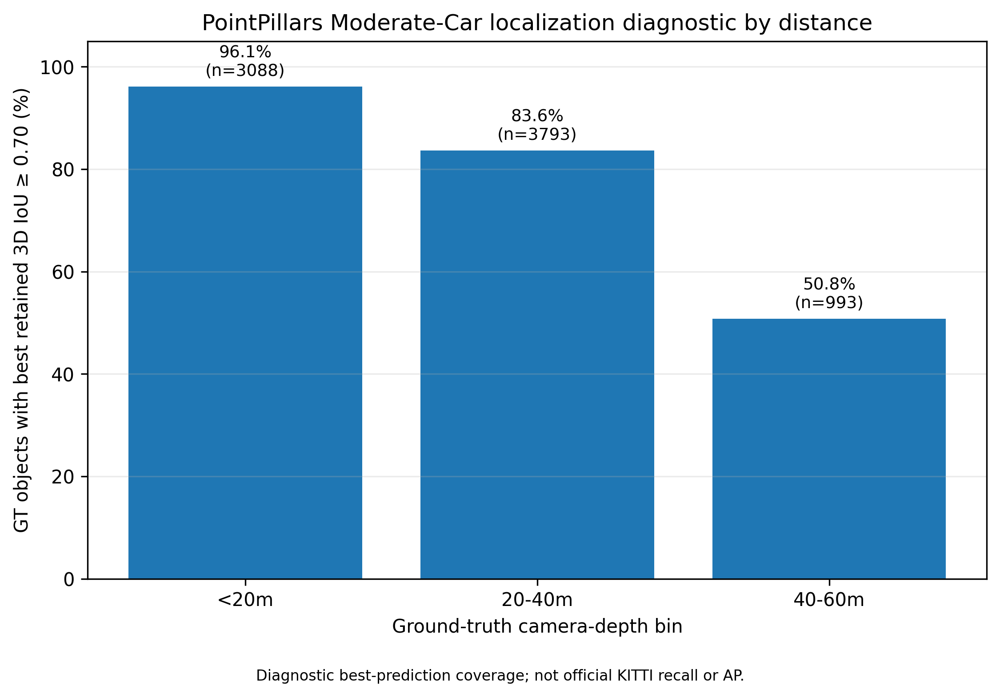

[Open figure](../results/kitti/pointpillars/figures/pointpillars_distance_diagnostic.png) · [Experiment folder](../results/kitti/pointpillars/figures/)

### pointpillars kitti ap40 strict

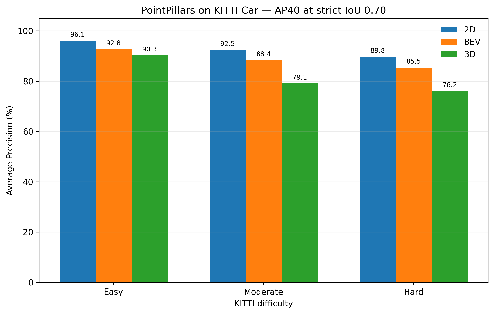

[Open figure](../results/kitti/pointpillars/figures/pointpillars_kitti_ap40_strict.png) · [Experiment folder](../results/kitti/pointpillars/figures/)

## PointPillars selected case studies

### pointpillars case distant localisation near miss 004096

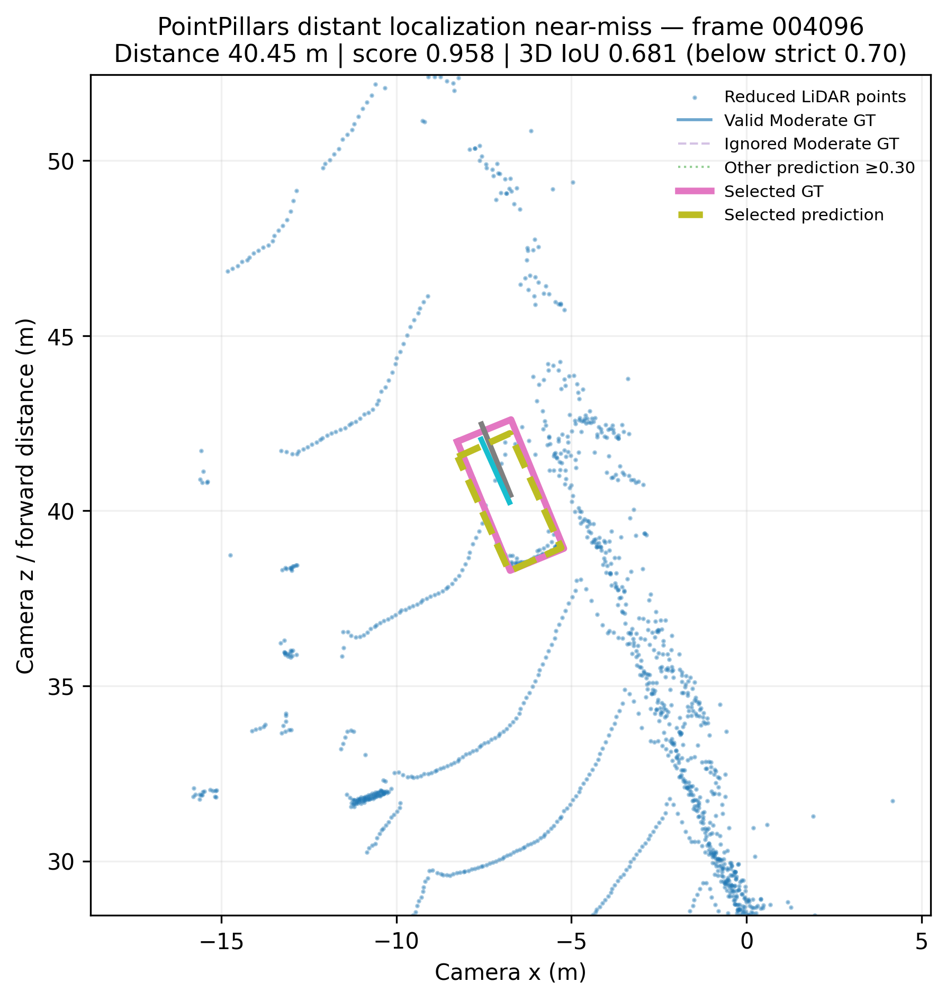

[Open figure](../results/kitti/pointpillars/case_studies/pointpillars_case_distant_localisation_near_miss_004096.png) · [Experiment folder](../results/kitti/pointpillars/case_studies/)

### pointpillars case distant success 002744

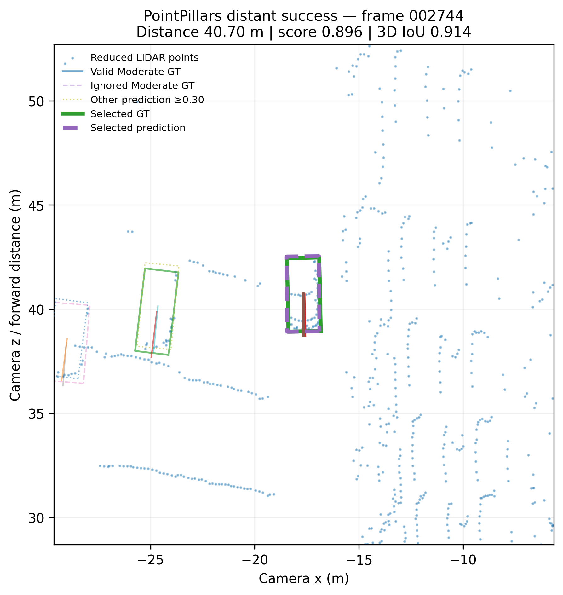

[Open figure](../results/kitti/pointpillars/case_studies/pointpillars_case_distant_success_002744.png) · [Experiment folder](../results/kitti/pointpillars/case_studies/)

### pointpillars case high confidence unmatched 001199

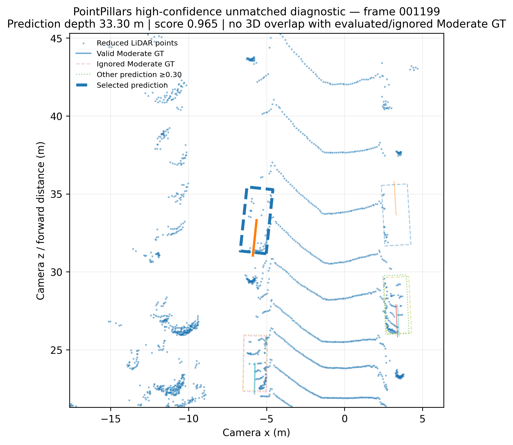

[Open figure](../results/kitti/pointpillars/case_studies/pointpillars_case_high_confidence_unmatched_001199.png) · [Experiment folder](../results/kitti/pointpillars/case_studies/)

## CLOCs seed and epoch diagnostics

### epoch12 to24 candidate ap

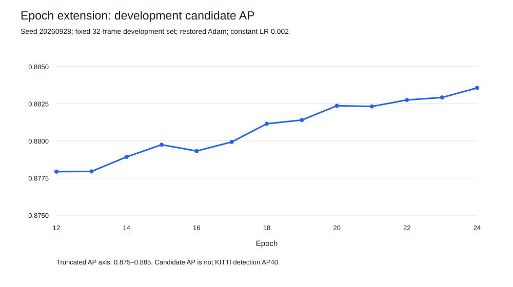

[Open figure](../results/kitti/clocs/seed_diagnostics/epoch12_to24_candidate_ap.svg) · [Experiment folder](../results/kitti/clocs/seed_diagnostics/)

### three seed and epoch24 3d deltas

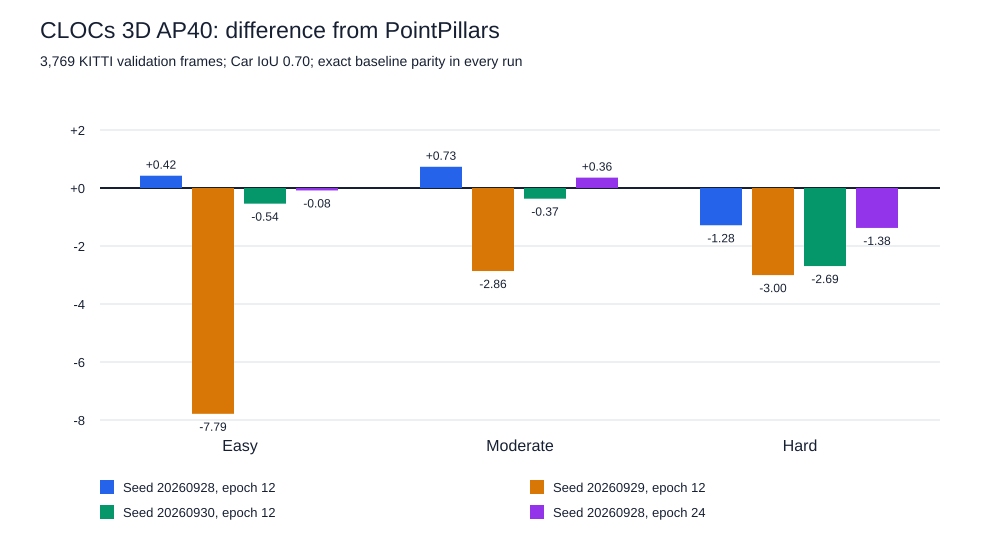

[Open figure](../results/kitti/clocs/seed_diagnostics/three_seed_and_epoch24_3d_deltas.svg) · [Experiment folder](../results/kitti/clocs/seed_diagnostics/)

## PV-RCNN benchmark comparison

### comparison

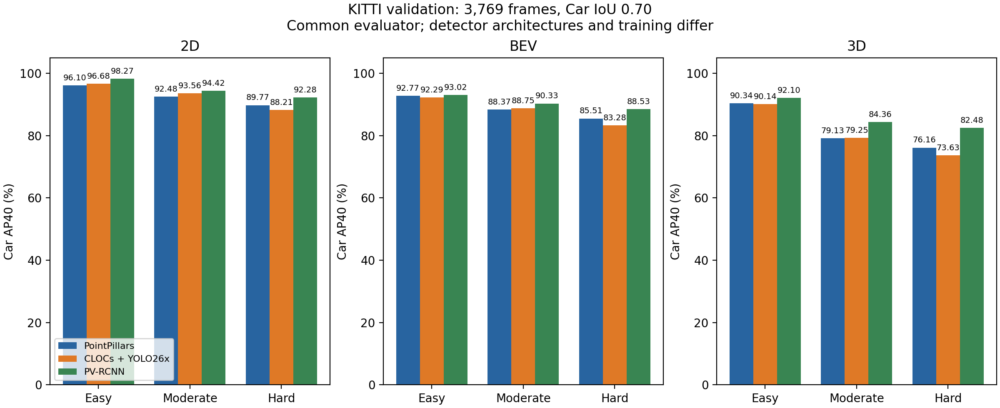

[Open figure](../results/kitti/pv_rcnn/validation/comparison.png) · [Experiment folder](../results/kitti/pv_rcnn/validation/)

## BEVFusion nuScenes subset

### class support

[Open figure](../results/nuscenes/bevfusion/validation_subset/class_support.png) · [Experiment folder](../results/nuscenes/bevfusion/validation_subset/)

### class support

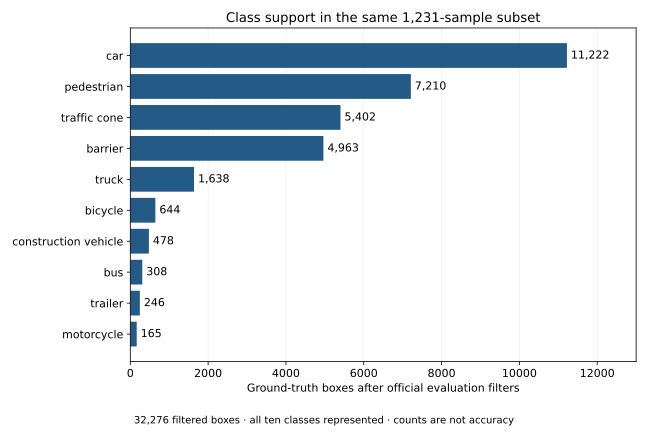

[Open figure](../results/nuscenes/bevfusion/validation_subset/class_support.svg) · [Experiment folder](../results/nuscenes/bevfusion/validation_subset/)

### comparison

[Open figure](../results/nuscenes/bevfusion/validation_subset/comparison.png) · [Experiment folder](../results/nuscenes/bevfusion/validation_subset/)

### comparison

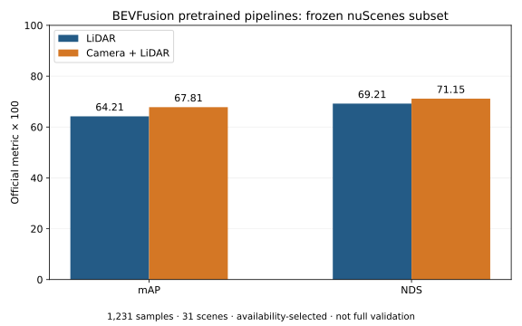

[Open figure](../results/nuscenes/bevfusion/validation_subset/comparison.svg) · [Experiment folder](../results/nuscenes/bevfusion/validation_subset/)

## Camera and depth studies

### camera detector comparison

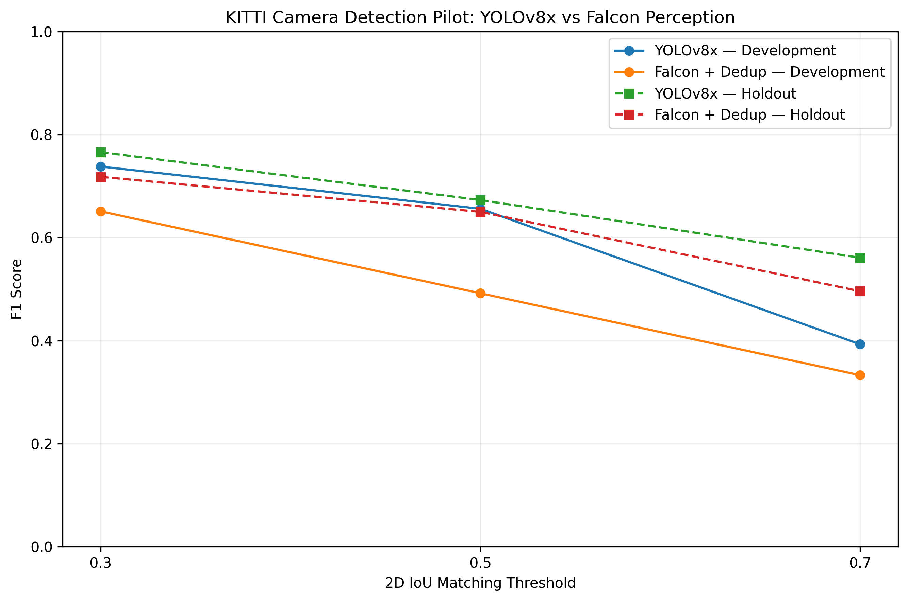

[Open figure](../results/kitti/camera/detector_comparison/figures/camera_detector_comparison.png) · [Experiment folder](../results/kitti/camera/detector_comparison/figures/)

### yolov8 falcon lidar comparison

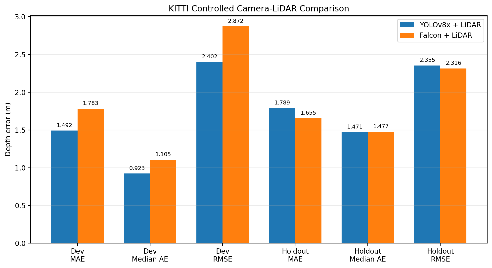

[Open figure](../results/kitti/camera/lidar_depth_comparison/figures/yolov8_falcon_lidar_comparison.png) · [Experiment folder](../results/kitti/camera/lidar_depth_comparison/figures/)

### yolov8 yolo26 lidar comparison

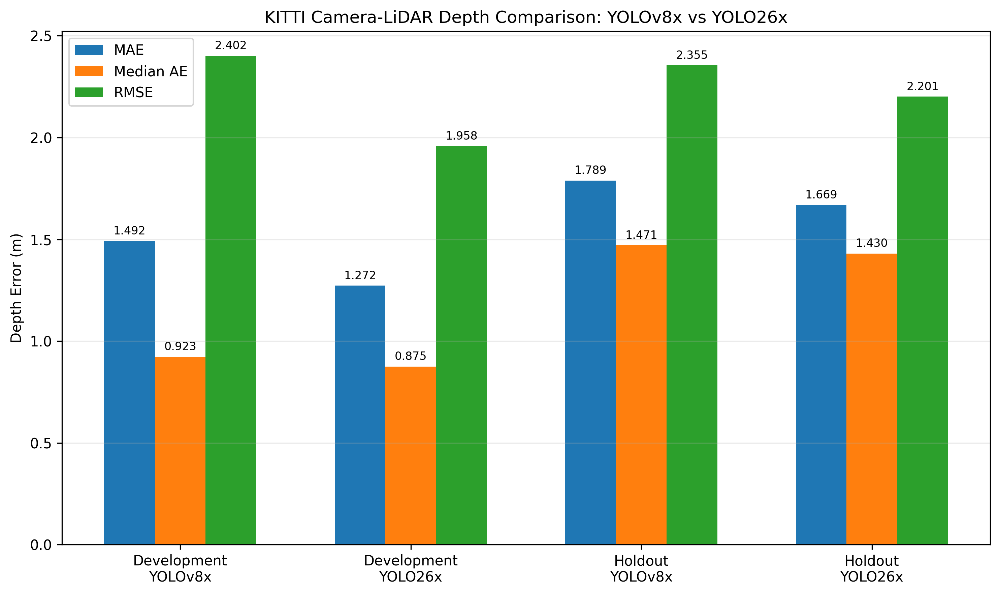

[Open figure](../results/kitti/camera/lidar_depth_comparison/figures/yolov8_yolo26_lidar_comparison.png) · [Experiment folder](../results/kitti/camera/lidar_depth_comparison/figures/)

## Reading the figures

KITTI AP40 and nuScenes mAP/NDS are different metrics. Selected case studies illustrate individual outcomes, not their prevalence. The nuScenes subset is availability-selected; neither mini nor subset is full validation. Historical raw-cloud CLOCs plots are intentionally excluded from this review gallery. Read each experiment’s findings for the supported interpretation.
