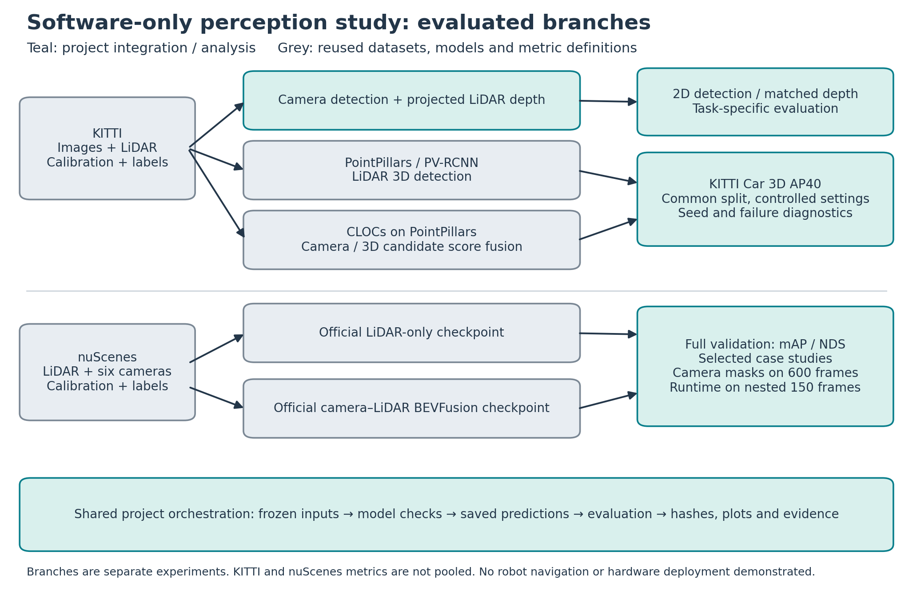
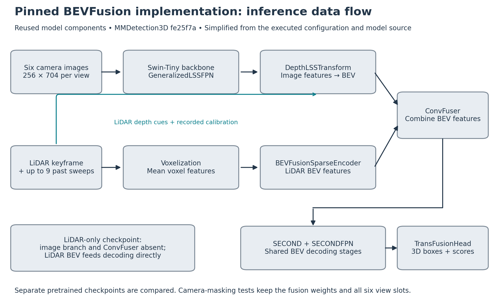

# Architecture and study scope

These diagrams explain the implemented study; they do not propose a new detector architecture or demonstrate physical robot deployment.

## Software study overview

Teal denotes integration, orchestration and analysis performed in this project. Grey identifies reused datasets, model architectures and metric definitions. The CLOCs architecture is reused while its project implementation, constrained training and diagnostics are part of the work. KITTI and nuScenes branches are separate experiments, not a chain in which one detector's output necessarily feeds the next. Camera 2D/depth results and 3D AP are different tasks.

## Pinned BEVFusion inference

Simplified from the saved runtime resolved configurations and [MMDetection3D BEVFusion source at fe25f7a](https://github.com/open-mmlab/mmdetection3d/blob/fe25f7a51d36e3702f961e198894580d83c4387b/projects/BEVFusion/bevfusion/bevfusion.py), especially extract_feat, extract_img_feat, extract_pts_feat and voxelize. Camera features use Swin-Tiny and GeneralizedLSSFPN; the depth-aware view transform uses image features, LiDAR points and calibration. LiDAR features come from voxelization with mean reduction and the sparse encoder. ConvFuser combines the two BEV representations before SECOND, SECONDFPN and TransFusionHead. The LiDAR-only checkpoint omits the image/fusion branches and uses its separate trained weights.

Recorded extrinsic/intrinsic calibration is used; the project does not estimate new sensor calibration here. Temporal LiDAR sweeps are from a single physical sensor. The diagram omits implementation-level tensor reshapes, coordinate transforms and batching.

PNG, PDF and editable-text SVG versions are in this directory. Regenerate from the repository root with `python scripts/draw_perception_architecture.py`. The [runtime experiment](../../results/nuscenes/bevfusion/runtime/20261015/README.md) separately defines the measured timing boundary: CPU-prepared batch through synchronized test_step, excluding file loading.
