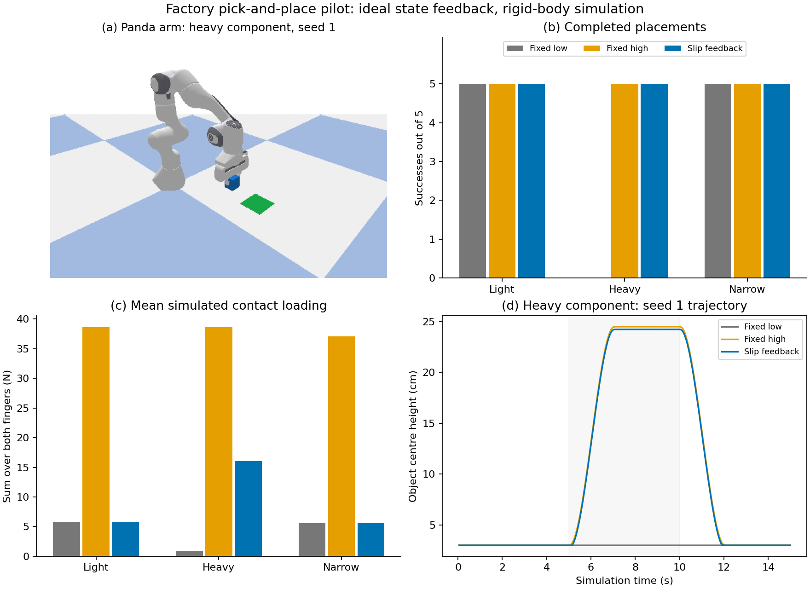

# Simulated factory-component pick-and-place pilot — 22 October 2026

**Status: 45 exploratory trials completed in PyBullet on CPU.** This is an additional robotics-control study. It does not run the project's KITTI/nuScenes detectors, demonstrate physical handling, or establish an A1 grade.

## Research question and result

Can a simple grip policy that responds to observed downward slip complete a pick-and-place task with less contact loading than a high fixed motor limit?

Three abstract rigid components were tested with five paired initial position offsets and three policies. The low fixed limit completed 10/15 placements, the high fixed limit 15/15, and slip feedback 15/15. All low-limit failures occurred for the heavy-component profile. Within that profile, feedback reduced mean simulated contact loading from 38.63 N to 16.08 N compared with the high fixed limit (58.36% lower), while both completed 5/5 placements. The feedback policy ended at a 9 N motor limit per finger for the heavy profile and remained at 3 N for the light and narrow profiles.

This is evidence of a tradeoff in this specific idealised setup. It is not evidence that the feedback policy is optimal, robust to sensor error, or safer for fragile objects. The high fixed baseline is deliberately conservative, not an optimised baseline. An intermediate fixed limit might also succeed with lower loading and has not been evaluated. There is no deformation, fracture or damage model.



**Figure caption.** Exploratory Panda-arm pick-and-place simulation with three rigid-box profiles, three grip policies and five paired XY offsets per profile (45 trials). (a) Preselected heavy-profile feedback trial, seed 1. (b) Completed placements under the frozen lift, endpoint and velocity criteria. (c) Mean sum of finger-object normal contact forces during gripping phases, including failed trials. Low loading alone is not desirable: the low-limit heavy trials failed. (d) Preselected heavy-profile seed-1 height trajectories. Feedback recovered task completion with lower loading than the high-limit baseline in this setup. Poses and slip observations are supplied by the simulator; no learned perception or physical validation is included. CPU, PyBullet 3.2.7, 240 Hz physics; simulated duration 15 s/trial, not a measured real-robot cycle time.

See the [compact results table](results/summary.md), [all trial outcomes](results/trials.csv), and [CSV summary](results/summary.csv).

## Implemented task

- A seven-joint Panda arm with two motor-driven fingers approaches, descends, closes, lifts, holds, translates 0.22 m, lowers, releases and retreats.
- All policies use identical smoothstep Cartesian waypoints and inverse-kinematics/position-controlled arm motion. The scene contains no clutter requiring obstacle avoidance; this is not a general motion planner.
- Objects move through gravity, contacts and friction. No object is attached to the arm by a constraint, and objects are not repositioned after initialisation.
- Profiles: light, 0.08 kg / 50×50×60 mm / friction 0.8; heavy, 0.5 kg / 50×50×60 mm / friction 0.4; narrow, 0.12 kg / 24×24×80 mm / friction 0.5. These are assumed surrogates, not measurements of commercial parts or validated material types.
- Initial XY offsets are drawn independently within ±3 mm and paired across policies. Seeds 1–5 were frozen before the evaluation. A distinct 0.2 kg development profile with seed 0 was used to debug basic grasp and placement feasibility.

## Policies and measurements

1. **Fixed low:** maximum finger-motor effort 3 N per finger.
2. **Fixed high:** maximum finger-motor effort 20 N per finger.
3. **Slip feedback:** initially 3 N. During lift/hold/transfer, at 20 Hz, increase by 2 N when the object's height relative to the grasp link decreases by more than 0.2 mm since the preceding observation; cap at 20 N. There is no decrease rule. Object mass and friction are not inputs to this policy.

The feedback policy uses perfect simulator poses as a relative-height slip proxy. It is not a simulated GelSight sensor, a learned grasp policy, direct contact-force regulation, or an impedance controller. Implementing equivalent feedback on hardware would require an appropriate estimator and consideration of noise and delay. Vertical relative motion can also reflect rotation or compliance; it is not a universal slip detector.

Commanded motor limits and measured normal contact forces are distinct. Forces in the table are the sum of contacts on both fingers; motor limits are per finger. Dynamic contact peaks can exceed a simple multiple of the motor limit. The summary computes contact statistics at every 240 Hz physics step during close/lift/hold/transfer/lower. Saved diagnostic traces are downsampled to 20 Hz; replay the simulator to recompute full-rate aggregate peaks.

Stable lift requires the object to remain more than 0.12 m above its nominal resting centre throughout hold and transfer. Completed placement additionally requires final XY error <30 mm, final centre height within 10 mm of its resting value and final speed <0.02 m/s. Orientation is not part of the success criterion. Successful mean XY errors are approximately 13–14 mm: this is coarse placement, not precision assembly. The supplementary [endpoint tolerance check](results/endpoint_tolerance.csv) is a post-hoc diagnostic and does not replace the frozen criterion. At a stricter 10 mm XY tolerance, none of the trials passes. At 20 mm, the same 40/45 pass as at 30 mm. The source of the systematic endpoint offset has not been isolated.

## Evidence boundary and relation to the dissertation

The main dissertation establishes detection accuracy, robustness and runtime. This pilot illustrates a separate downstream robotics requirement: the action must respond to interaction evidence after perception has supplied a pose. It supports a discussion of sensing-to-action architecture, but it does not demonstrate that camera–LiDAR fusion improved grasping. Neither road-scene training data nor benchmark mAP establishes factory-component recognition, grasp success or object damage avoidance.

Limitations include rigid-body contact assumptions, ideal state feedback, a small position-perturbation sample, one simulator and simple unobstructed trajectories. Component profiles jointly vary several properties, so differences between profiles cannot isolate the causal effect of mass, shape or friction. No confidence interval is presented as a physical reliability estimate. A single selected trial was replayed in a fresh process; that checks local numerical repeatability only.

Any next study should address a specific gap: compare an intermediate fixed limit, inject realistic observation errors, or use object-specific visual pose estimates. These are pending. A physical deployment would require further validation. The report should allocate approximately one page to this pilot within the robotics application discussion, using this single composite and compact table rather than expanding into another dissertation.

## Reproduction

Use Python 3.11; the recorded run used 3.11.17. The initial Python 3.12 PyBullet source build failed because a C++ compiler was unavailable; an isolated Python 3.11 environment and prebuilt PyBullet wheel resolved setup. MuJoCo was considered during setup but was not used for any result.

```bash
python -m venv .venv
source .venv/bin/activate
python -m pip install -r requirements.txt
python scripts/run_arm_study.py --mode smoke --output development_replay
python scripts/run_arm_study.py --mode evaluate --output results
python scripts/summarise_arm_study.py
```

The evaluation script checks its own SHA-256 against [protocol.json](protocol.json). Record checks cover all expected trial keys, paired offsets, trace duration, finite values and motor-limit bounds. [audit.json](results/audit.json) records versions and the bundled Panda URDF hash. [replay_check.json](results/replay_check.json) records the selected same-simulator replay. [manifest.json](manifest.json) hashes the preserved artifacts.

The [compressed trace archive](results/diagnostic_traces.zip) contains all 45 CSV traces and the single source screenshot needed by the composite script. Extract its members into `results/` to regenerate the figure without rerunning physics. The full run additionally regenerates phase snapshots. Generated simulation outputs have no dependence on downloaded road-scene datasets. The rendered Panda asset comes from `pybullet_data/franka_panda`; its bundled Apache 2.0 licence is retained in [PANDA_ASSET_LICENSE.txt](PANDA_ASSET_LICENSE.txt). Robot meshes are installed by the dependency and are not copied into this repository.

## Technical sources

- Bullet Physics, [Panda simulation example](https://github.com/bulletphysics/bullet3/blob/master/examples/pybullet/gym/pybullet_robots/panda/panda_sim.py) and [PyBullet Quickstart Guide](https://github.com/bulletphysics/bullet3/blob/master/docs/pybullet_quickstart_guide/PyBulletQuickstartGuide.md.html), checked 22 October 2026. The implementation uses the package's Panda asset and APIs; experiment code and protocol are specific to this pilot.
- Lynch and Park, [Modern Robotics, Chapter 11](https://modernrobotics.northwestern.edu/chapters/chapter11/), for distinguishing motion, force and impedance control. The present policy adjusts an actuator limit from a slip proxy.
- Liu and Adelson, [GelSight Fin Ray](https://arxiv.org/abs/2204.07146), for the wider motivation for compliant tactile manipulation. That sensor and its physical demonstrations are not reproduced here.
