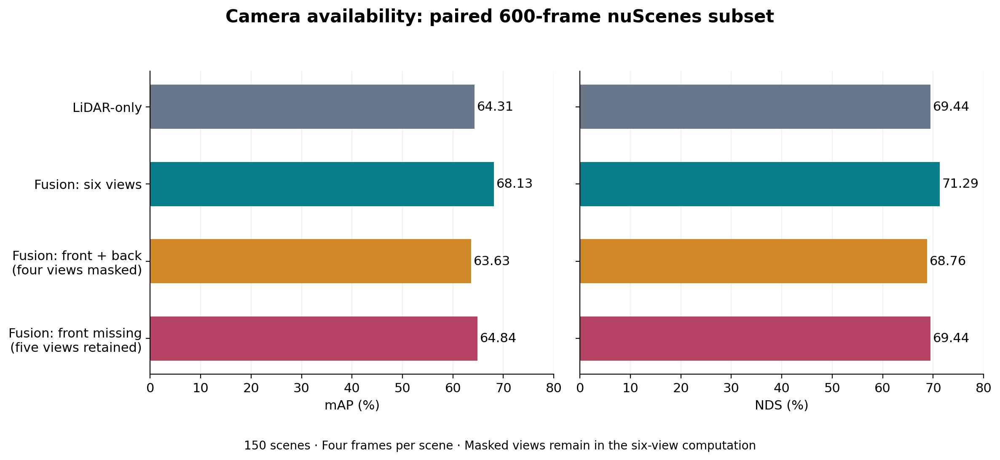

# Camera availability — 600-frame nuScenes experiment

Four frames from each of the 150 official validation scenes, selected by timestamps independently of prediction outcomes. This study evaluates missing-view robustness of a six-camera BEVFusion checkpoint.

## Measured comparison

| Condition | mAP (%) | NDS (%) | Δ mAP vs intact fusion (points) | Δ NDS vs intact fusion (points) |
|---|---:|---:|---:|---:|
| LiDAR-only checkpoint | 64.31 | 69.44 | -3.82 | -1.85 |
| Fusion: six camera views | 68.13 | 71.29 | +0.00 | +0.00 |
| Fusion: front/back retained; four masked | 63.63 | 68.76 | -4.50 | -2.53 |
| Fusion: front masked; five retained | 64.84 | 69.44 | -3.29 | -1.85 |



## Find figures and evidence

- [Findings, interpretation and limitations](FINDINGS.md).
- [Per-class AP and support](figures/class_ap.png), [per-class masking effect](figures/class_mask_delta.png).
- [Figures in PNG/PDF/SVG](figures/), [exact tables](tables/).
- [Original evaluation records](original_evidence/evaluation/), including summaries, metric details, curves and evaluator code.
- [Frozen selection protocol](original_evidence/protocol.json), [sample tokens](original_evidence/sample_tokens.txt), [sensor restoration audit](original_evidence/sensor_restoration_audit.json).
- [Smoke checks](original_evidence/smoke/), [inference code and logs](original_evidence/inference/), [setup records](original_evidence/setup/).
- [Original evidence manifest](evidence_manifest.json), [raw prediction receipt](raw_prediction_receipt.json), [import verification](import_audit.json), [figure manifest](figure_manifest.json).

Raw predictions, serialized frame outputs, annotation pickle and sensor archives remain separately on Google Drive. Their absence from this compact Git import is intentional; these files are needed to replay inference/evaluation. No existing historical results are replaced.

## Reproduce figures

From the repository root:

```bash
python scripts/plot_camera_availability_results.py
```

Requires NumPy and Matplotlib. The script verifies metric hashes and stored metric arithmetic before generating figures. This verifies plotting inputs and arithmetic; it does not replay evaluation from ground truth.
