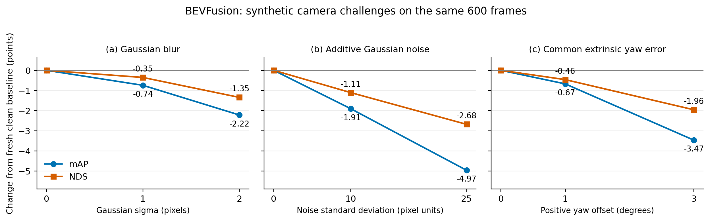

# Camera challenges — 16 October 2026

Seven conditions / 600 frozen frames / 150 validation scenes: fresh clean, Gaussian blur sigma 1/2, additive Gaussian noise SD 10/25, and geometrically consistent common extrinsic yaw +1°/+3°. Official pretrained camera–LiDAR BEVFusion; no new detector training.

**Report caption:** Change in mAP and NDS (points, metrics multiplied by 100) from this study's clean baseline, on the same 600 frames and 12,318 filtered GT objects. Each intervention is applied alone; LiDAR points are unchanged. Sigma and noise units refer to resized encoded image values; calibration is common rig-to-LiDAR positive yaw. Lines connect tested settings and do not establish continuous behaviour. Families use different severity scales. No uncertainty intervals were computed.

Use this one three-panel image and the [exact-value table](tables/headline_metrics.csv) for the main report. The [class AP heatmap](figures/class_ap_delta.png) is supporting detail for the appendix/repository. PDF and SVG versions accompany both figures.

- [Findings, methods and limitations](FINDINGS.md)
- [Class AP table](tables/class_ap.csv) and [TP-error table](tables/tp_errors.csv)
- [Original evidence](original_evidence/evidence_manifest.json): all 270 archive members, including frozen protocol, scripts, setup/smoke diagnostics, input ledgers, metrics and evaluator curves
- [Archive receipt](archive_receipt.json), [import audit](import_audit.json), [analysis summary](analysis_summary.json)
- [Reproduction script](../../../../../scripts/plot_camera_challenges_results.py): run from repository root with no arguments

Raw prediction files, per-frame checkpoints and sensors remain separately preserved. The compact archive is not the raw prediction archive. Earlier clean values are not substituted for this study's baseline.
