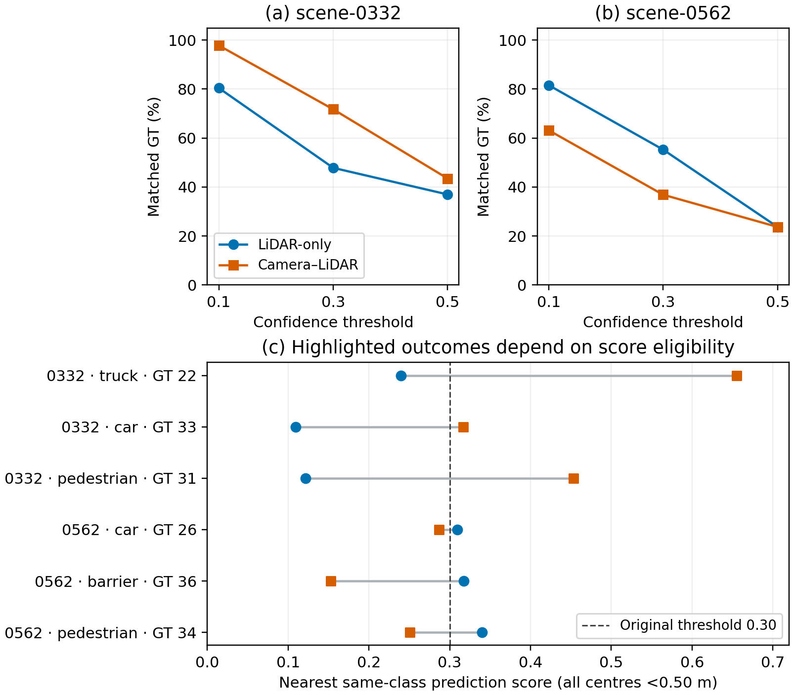

# Quantitative case diagnostics — 20 October 2026

This analysis extends the six preserved visual cases with a CPU replay of matching, a confidence-threshold sensitivity check and object-level diagnostics. It generates new diagnostic data from existing predictions; it does not rerun inference or update the full-validation mAP/NDS.

## Main result

The two detailed frames exhibit opposite operating-point outcomes. In both, nearby same-class predictions frequently exist below the chosen score threshold. Therefore, a cross labelled “miss” in the original figure must not be described as proof that the model produced no geometrically plausible candidate.

| Frame | Filtered GT | LiDAR TP / FP / FN | Fusion TP / FP / FN | Recall, LiDAR → fusion | Fusion-only / LiDAR-only matches |
|---|---:|---:|---:|---:|---:|
| scene-0332 | 46 | 22 / 2 / 24 | 33 / 3 / 13 | 47.83% → 71.74% | 11 / 0 |
| scene-0562 | 38 | 21 / 2 / 17 | 14 / 3 / 24 | 55.26% → 36.84% | 0 / 7 |

Table: two outcome-selected nuScenes validation frames; score ≥0.30, identical class, global XY centre distance <2 m, greedy confidence-ordered one-to-one matching. These are diagnostic counts and recall, not official AP or NDS. Original predictions came from two separately pretrained BEVFusion pipelines; the comparison does not isolate the causal effect of adding cameras.

## What the new data show

**scene-0332:** fusion-only matches comprise five cars, four pedestrians and two trucks. All 11 objects have a same-class LiDAR prediction within 2 m whose nearest-candidate score is below 0.30. Ten have no score-eligible same-class LiDAR prediction within 2 m. The remaining pedestrian, filtered GT index 10, has an eligible LiDAR prediction (index 9, score 0.438677) within 1.439584 m, but it is assigned to a nearer pedestrian (GT 40, distance 0.050496 m). This case therefore includes assignment competition as well as score eligibility; not every miss can be reduced to a missing high-score nearby candidate. At threshold 0.10, nine of the original 11 LiDAR misses become matches.

**scene-0562:** all seven LiDAR-only matches have nearby same-class fusion candidates but no score-eligible fusion candidate within 2 m at threshold 0.30. Their classes are four barriers, two pedestrians and one car. Six become fusion matches at threshold 0.10. The remaining barrier's nearest fusion candidate scores 0.043181. This accounts for the operational matching outcomes, not the learned cause of the score differences.

All six objects highlighted in the two original figures have nearby same-class candidates in both models. The three highlighted misses in each frame are recovered when matching is replayed at threshold 0.10. Examples:

| Frame / filtered GT index | Class | Nearest LiDAR score / XY error (m) | Nearest fusion score / XY error (m) |
|---|---|---:|---:|
| 0332 / 22 | truck | 0.239638 / 0.079856 | 0.655316 / 0.176866 |
| 0332 / 33 | car | 0.109168 / 0.491435 | 0.316909 / 0.242591 |
| 0332 / 31 | pedestrian | 0.121834 / 0.197525 | 0.452989 / 0.153747 |
| 0562 / 26 | car | 0.309195 / 0.077372 | 0.286567 / 0.095084 |
| 0562 / 36 | barrier | 0.317495 / 0.106144 | 0.152858 / 0.123132 |
| 0562 / 34 | pedestrian | 0.340260 / 0.100964 | 0.250852 / 0.162202 |

Table: scores and centre errors of the nearest same-class saved candidate, independent of score eligibility. They are not calibrated probabilities or complete 3D-box-quality measures. GT indices refer to the saved filtered per-frame list, not original nuScenes annotation tokens. Candidate identities differ across models.

## Sensitivity and localisation

| Frame | Threshold | TP, LiDAR / fusion | FP, LiDAR / fusion |
|---|---:|---:|---:|
| scene-0332 | 0.10 | 37 / 45 | 15 / 12 |
| scene-0332 | 0.30 | 22 / 33 | 2 / 3 |
| scene-0332 | 0.50 | 17 / 20 | 1 / 2 |
| scene-0562 | 0.10 | 31 / 24 | 14 / 8 |
| scene-0562 | 0.30 | 21 / 14 | 2 / 3 |
| scene-0562 | 0.50 | 9 / 9 | 0 / 0 |

Lowering the threshold recovers matches and admits false positives; it is not a demonstrated improvement in system utility. In scene-0562 at 0.50, equal TP counts hide different identities: eight shared matches, one LiDAR-only and one fusion-only. Neither threshold was selected as an optimum. No model scores were recalibrated.

For localisation comparisons, use the same GT identities rather than different matched populations. At threshold 0.30, scene-0332 has 22 shared matches and scene-0562 has 14. Their median paired differences in XY centre error (fusion minus LiDAR) are +0.003633 m and +0.007862 m respectively. These selected-frame differences are descriptive; they do not establish statistically significant localisation degradation. Individual-model median errors and the median of paired differences are distinct statistics.

## Compact report figure



**Caption:** Confidence-threshold sensitivity on two selected nuScenes validation frames. Panels (a–b) show the fraction of filtered GT matched by each pretrained pipeline at scores 0.10, 0.30 and 0.50 using a fixed same-class XY-distance rule (<2 m). Connecting lines guide the eye; intermediate thresholds were not evaluated. Panel (c) shows nearest same-class candidate scores for the six objects highlighted in the earlier camera/BEV figures; all centre errors are below 0.50 m. The 0.30 line explains the highlighted operating-point differences, while the frame-level curves expose changing TP/FP tradeoffs. This CPU replay uses saved predictions, not fresh inference or official AP evaluation. Outcome-selected examples do not estimate population failure frequency.

Use this one composite figure with one condensed results table in the report. The other tables and CSVs can remain supporting material. Existing camera/BEV views are linked in the [original case folder](../../case_studies/20261013/annotated_cases/README.md); duplicating all six figures in the report is unnecessary.

## Verification and reproduction

The original six-case input ZIP SHA-256 matches the hash already recorded in GitHub: `574a5ea93c4fc455317562caaa82a30f25ce3f8b20715ddbf2e05c0cff0b9bdd`. All 12 saved model–case match lists, FP lists and FN lists were reproduced exactly at threshold 0.30. Three thresholds × six frames × two models produce 36 summary rows. Detailed ledgers contain 36 discordant-object/model rows and 12 highlighted-object/model rows for the two focus frames.

From the repository root, with the original `nuscenes_six_case_annotation_inputs.zip` available outside Git:

```bash
python scripts/analyse_saved_nuscenes_cases.py --inputs /path/to/nuscenes_six_case_annotation_inputs.zip --output results/nuscenes/bevfusion/case_analysis/20261020
python scripts/plot_saved_nuscenes_cases.py --data results/nuscenes/bevfusion/case_analysis/20261020
```

The diagnostic replay uses the Python standard library. The figure additionally requires Matplotlib (executed version recorded in `manifest.json`). The input ZIP contains licensed sensor data and remains outside this compact Git import. Generated CSVs, scripts, audit and figure files are preserved here. The plot was visually checked; this is not a fresh SDK filtering run or a full-validation replay.

## Limits and next evidence

The original candidate search selected high-outcome-count frames, then visual review selected six cases. Today's two focus cases were chosen from that existing set for contrasting outcomes and class diversity. The three added thresholds are exploratory, selected after inspecting the original results. Do not use these cases to tune a deployment threshold, estimate failure prevalence or infer causal effects of shade, fencing or occlusion. A class-correct nearby centre does not establish correct size, yaw, velocity or semantics. The saved candidate set is post-inference; pre-NMS candidates were not examined. Follow-up work should test any score-calibration or fusion remedy on an independent development protocol before evaluation, rather than treating these validation cases as training evidence.
