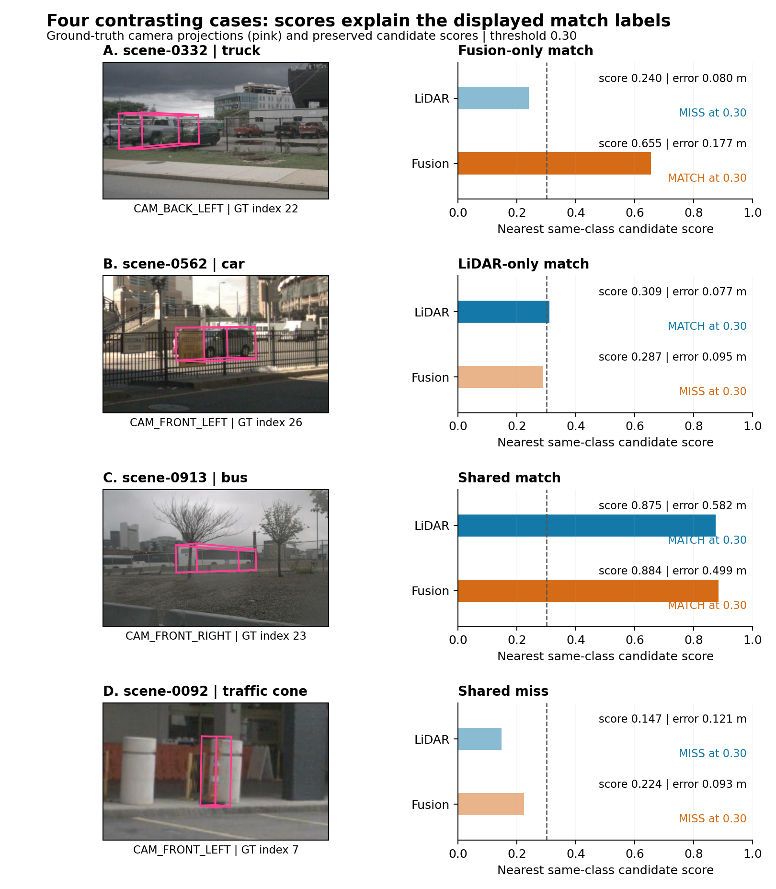

# Four contrasting detection cases: evidence and critical discussion

Supervisor brief | 25 October 2026 | No new detector inference

**Figure 1.** Four illustrative nuScenes validation objects, selected from the six preserved cases. Pink camera wireframes are projected ground truth, not model predictions. Bars show the nearest same-class saved candidate score; the dashed line marks 0.30. Error is global XY centre distance to the highlighted ground truth. Match labels additionally require distance <2 m and confidence-ordered one-to-one assignment. These four candidates have no assignment conflict at 0.30. Camera crops are enlarged without enhancement; projection uses camera-time ego pose and sample-time boxes, without object-motion compensation or an occlusion test. Dataset class labels are retained. The figure diagnoses operating-point outcomes, not causal effects of image appearance.

<!-- PAGEBREAK -->

## Evidence and method

Four frames were chosen from the six previously preserved, outcome-selected cases to illustrate fusion-only matching, LiDAR-only matching, shared matching and shared failure. One previously highlighted object per frame provides a readable connection between image evidence and quantitative diagnostics. This is an editorial selection, not a representative sample. The original archive hash and the four camera-image hashes were verified. A CPU replay reproduced the saved matching identities at score 0.30 for both models in all six frames, and all 36 saved model/threshold count summaries at scores 0.10, 0.30 and 0.50. No inference or official ground-truth filtering was rerun [1].

**Table 1.** All-class frame counts at score >=0.30 and same-class XY centre distance <2 m. TP = matched prediction, FP = unmatched prediction, FN = unmatched ground truth under this diagnostic. Shared counts compare ground-truth identities. These frame-level counts include objects beyond the single highlighted object in Figure 1; they are not official mAP/NDS.

| Case / scene | Filtered GT | LiDAR TP / FP / FN | Fusion TP / FP / FN | Shared matches / misses | Fusion TP minus LiDAR |
|---|---:|---:|---:|---:|---:|
| A / 0332 | 46 | 22 / 2 / 24 | 33 / 3 / 13 | 22 / 13 | +11 |
| B / 0562 | 38 | 21 / 2 / 17 | 14 / 3 / 24 | 14 / 17 | -7 |
| C / 0913 | 79 | 71 / 1 / 8 | 72 / 1 / 7 | 71 / 7 | +1 |
| D / 0092 | 45 | 10 / 3 / 35 | 11 / 1 / 34 | 9 / 33 | +1 |

## A. Fusion benefit does not imply better centre localisation

In scene-0332, fusion adds 11 matches across cars, pedestrians and trucks, while false positives increase from two to three. For the highlighted truck (GT index 22), the LiDAR candidate has score 0.239638 and centre error 0.079856 m; fusion has score 0.655316 and error 0.176866 m. The LiDAR candidate is actually closer to the ground-truth centre, but fails the 0.30 score requirement. Both match at 0.10. Thus this example demonstrates improved score eligibility at the selected operating point, not an improvement in every geometric attribute. Several vehicles are visible in the crop, but the image does not establish which features caused the score difference.

The practical implication is to inspect scores and geometry separately before describing a fusion-only match as a recovered invisible object. Lowering the frame-wide threshold to 0.10 increases LiDAR matches from 22 to 37, but also increases false positives from two to 15. The corresponding fusion counts rise from 33 to 45 matches and from three to 12 false positives. Threshold reduction is therefore a trade-off to evaluate on separate development data, not a validated remedy derived from this selected frame.

## B. Fusion regression can arise close to the score boundary

In scene-0562, fusion matches seven fewer objects and produces one more false positive. The highlighted car (GT index 26) has LiDAR score 0.309195 and error 0.077372 m, versus fusion score 0.286567 and error 0.095084 m. Both candidates are geometrically close, but their scores straddle 0.30. Both match at 0.10 and neither matches at 0.50. Fencing and signs overlap the projected region in this view; their causal effect on the models is not established. The defensible explanation is the immediate score-selection mechanism, rather than a claim that fusion failed to generate a car candidate.

<!-- PAGEBREAK -->

## C. Shared success is a necessary counterexample

In scene-0913, 71 ground-truth objects are matched by both pipelines, and fusion matches one additional object. Each model has one false positive. For the highlighted bus (GT index 23), scores are 0.874543 and 0.884482, with centre errors of 0.582070 m and 0.498960 m for LiDAR and fusion respectively. Both retain the match at every tested threshold. Fusion's centre error is about 0.083 m smaller for this object, but this does not establish better size, orientation or velocity estimation.

The crop has subdued contrast and foreground vegetation, yet both models succeed under the matching rule. This counterexample prevents a discussion based only on visually difficult failures. It does not establish weather robustness: there is no paired intervention or weather-stratified evaluation in this case study. The project's separate controlled corruption experiments answer a different question and cannot retrospectively prove why this particular bus was detected.

## D. Shared failure has both recoverable and unresolved components

In scene-0092, both models miss 33 of the same objects at 0.30, predominantly barriers and traffic cones. The highlighted traffic cone (GT index 7) has nearby candidates in both models: scores 0.146736 and 0.223667, with centre errors 0.120620 m and 0.093263 m respectively. Both recover this particular match at 0.10. The small projected object lies among roadside structures, but the crop alone cannot establish visibility or why its confidence is low.

Object-level recovery must not be confused with resolution of the frame's failures. At 0.10, 30 ground-truth objects are still missed by both pipelines. False positives rise from three to nine for LiDAR and from one to seven for fusion. This distinguishes a threshold-sensitive example from the larger unresolved shared-miss population. Further diagnosis would require candidate-level class, geometry and assignment checks for those remaining objects; the current image provides insufficient evidence to assign them a common cause.

## Synthesis, literature connection and limits

The four cases show why aggregate accuracy, operating-point matching and visual appearance must be discussed separately. A match can be gained or lost through score eligibility even when both models produce a nearby same-class candidate. Scores are not demonstrated calibrated probabilities, and a small centre error is not complete 3D-box correctness. The two pretrained pipelines have different weights and training histories; this is not a controlled experiment isolating the effect of adding cameras.

CLOCs provides a relevant design connection: its authors' implementation replaces original 3D candidate scores with fused scores before post-processing [2]. That motivates scrutiny of candidate ranking, but does not show that CLOCs would fix these cases. TransFusion proposes soft cross-modal association to address inferior image conditions and misalignment [3]. It is a literature-supported alternative, not an implemented mitigation here, and these cases do not establish association error as their cause.

The contribution is a traceable explanation of selected successes and failures, rather than a claim that fusion always helps. Neither these four frames nor their highlighted objects estimate failure prevalence. The separate robot-corridor analysis is also kept distinct: it measures spatial alerts, whereas this brief measures class-specific detection matches. Together they support critical discussion at different stages of the pipeline without equating detection accuracy with safe robot behaviour.

## Sources

[1] Project evidence: [six annotated cases](https://github.com/abjain182002/multimodal-perception/tree/main/results/nuscenes/bevfusion/case_studies/20261013/annotated_cases) and [20 October diagnostic replay](https://github.com/abjain182002/multimodal-perception/tree/main/results/nuscenes/bevfusion/case_analysis/20261020). Exact tokens, GT indices, new replay checks and source-file hashes accompany this brief.

[2] Pang, S., Morris, D. and Radha, H. (2020), CLOCs, IROS. [Authors' implementation](https://github.com/pangsu0613/CLOCs#fusion-of-other-3d-and-2d-detectors), Step 4. Checked 25 October 2026.

[3] Bai, X. et al. (2022), TransFusion, CVPR. [Authors' paper, abstract](https://arxiv.org/abs/2203.11496). Checked 25 October 2026. These targeted connections do not replace the dissertation's full literature synthesis.
