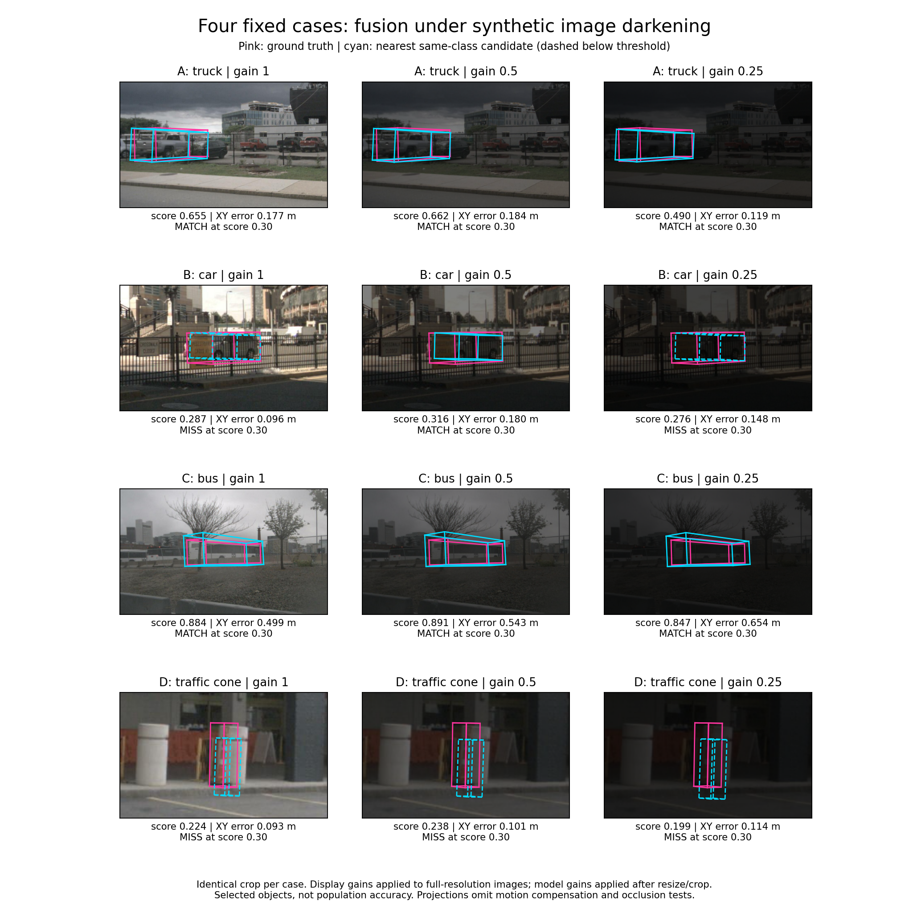

# Four-case darkening follow-up — 28 October 2026

**Diagnostic extension:** [eight-class threshold trade-offs, box errors, verified point support and an additional rain-labelled regression](extension/README.md). Exact all-class counts and verified night cases remain pending.

This CPU analysis uses the preserved 16 predictions: four LiDAR clean references and four fusion frames at each of image gains 1, 0.5 and 0.25. No new inference was performed during this analysis. The exported archive and its 46 payload members, plus the nested 75 input payload members, were hash-verified. Recorded point, metadata and raw-image hashes remain identical across fusion conditions. These checks verify recorded invariants, not a second execution of the transforms.



Individual comparisons: [Case A](results/case_A.png) · [Case B](results/case_B.png) · [Case C](results/case_C.png) · [Case D](results/case_D.png).

## Main finding

The response is object-specific and non-monotonic. At the frozen score threshold of 0.30, the highlighted clean outcomes reproduce: A fusion-only match, B LiDAR-only match, C shared match, D shared miss. Clean numerical predictions are not bitwise identical to the original records; `results/clean_reproduction.csv` reports the differences. Reproduction here means the eight highlighted model/object outcomes agree, not that all predictions agree numerically.

| Case / highlighted class | LiDAR clean score | Fusion clean | Fusion gain 0.5 | Fusion gain 0.25 |
|---|---:|---:|---:|---:|
| A / truck | 0.240, miss | 0.655, match | 0.662, match | 0.490, match |
| B / car | 0.309, match | 0.287, miss | 0.316, match | 0.276, miss |
| C / bus | 0.875, match | 0.884, match | 0.891, match | 0.847, match |
| D / traffic cone | 0.147, miss | 0.224, miss | 0.238, miss | 0.199, miss |

A match requires score >=0.30 and a score-ordered one-to-one same-class assignment at XY centre distance <2 m. Scores are detector outputs, not calibrated probabilities. The nearest same-class candidate is the assigned candidate whenever the highlighted object matches, verified at thresholds 0.10, 0.30 and 0.50.

## Critical discussion

**A — retained detection with lower score at stronger darkening.** Fusion retains the highlighted truck at all three gains under the primary threshold. Its score falls from 0.655 to 0.490 at gain 0.25, while its XY error improves from 0.177 to 0.119 m. Score and localisation therefore do not change together. At threshold 0.50, the quarter-brightness candidate becomes a miss. This is threshold sensitivity, not disappearance of the candidate.

**B — a threshold crossing, not uniformly better detection.** Half-brightness raises the car score from 0.287 to 0.316, changing the primary label to match. Its XY error increases from 0.096 to 0.180 m. At quarter brightness the score falls to 0.276 and the label returns to miss. This controlled input change demonstrates sensitivity to image values for this object, but does not identify the physical cause of the original regression. It does not establish that illumination, shadows, occlusion or camera–LiDAR alignment caused the original failure. At threshold 0.10 all four predictions match; at 0.50 none match.

**C — a retained match in a scene described as rainy.** The highlighted bus remains matched at every tested gain and threshold. At gain 0.25 its XY error increases from 0.499 to 0.654 m despite remaining matched. Official scene text includes “Rain”; this is observational context, not a measured frame-level rain intensity or a controlled rain intervention. One bus cannot establish general rain robustness.

**D — low confidence despite a nearby candidate.** The highlighted cone remains below score 0.30, but all fusion variants have a nearby same-class candidate with XY error around 0.09–0.11 m. Thus “shared miss” at the primary threshold does not mean no candidate exists. At threshold 0.10 both clean models and all fusion conditions match. Lowering a threshold can also introduce false positives elsewhere; this focal-object analysis does not establish a globally preferable threshold.

## Protocol and interpretation boundaries

- Four outcome-selected frames and one preselected object per frame; no frequency, statistical superiority or population robustness claim.
- Analysis uses preserved SDK-filtered ground truth. New predictions are filtered for the focal class and its ego-distance range: 50 m for truck/car/bus, 30 m for traffic cone. Bike-rack filtering is irrelevant to these four classes. No full-frame mAP/NDS or all-class counts are produced.
- Image-value gains are synthetic darkening, not real night, atmospheric attenuation, rain or fog. All six camera views were modified by inference; each figure shows one fixed relevant view.
- Camera projections use saved sensor extrinsics and camera-time ego poses without object-motion compensation or occlusion tests. Pink is GT; cyan is the nearest same-class prediction. Dashed cyan is below 0.30.
- Figure display crops apply gain to the original image, whereas model gains were applied after resize/crop before normalisation. They illustrate the intervention and are not exact packed model-input tensors.
- Source commit, checkpoints and execution settings are retained in the source export. This analysis does not validate robot deployment or manipulation.

## Figures for the supervisor and report

Use the composite below for one compact report figure. Vector PDFs are supplied in the separately preserved analysis bundle. Four individual `case_A`–`case_D` PNG figures include the LiDAR reference and three fusion conditions, useful for presentation or close inspection. Keep them out of the main report if the composite is sufficient.

Suggested caption: “Fixed-case fusion predictions under synthetic image darkening. Rows show a preselected truck, car, bus and traffic cone in cases A–D; columns show gains 1.0, 0.5 and 0.25. Pink denotes projected ground truth, cyan the nearest same-class candidate, dashed when below score 0.30. Match labels use one-to-one class-consistent matching at XY error <2 m. Case B crosses the score threshold only at gain 0.5, while its localisation error increases; cases A and C remain matched and D remains below threshold. These selected examples demonstrate heterogeneous responses, not population accuracy. Display crops illustrate gains rather than exact packed inputs; projections omit motion compensation and occlusion tests.”

## Reproduce on CPU

This public folder contains analysis scripts, derived tables and PNG figures. Raw sensor payloads are excluded. Obtain the preserved source export separately from the project Drive and rename it `source_export.zip`. Its SHA-256 is `6bbf19622627a1fe5e4307628ff12dc5f070828b3f3361b235e3df2fde7250f6`. Install the versions in `requirements.txt`, then run from this folder:

```bash
python verify_and_prepare.py --archive source_export.zip --output input
python analyse.py --input input --output regenerated_results
```

`object_evidence.csv` includes exact scores/errors and all three threshold outcomes. `clean_reproduction.csv` separates original and fresh clean values. `audit.json` states the limited validation scope. `manifest.json` records hashes of the public deliverables. Sensor images remain subject to the original dataset licence; possession of this bundle does not grant redistribution rights. Do not publish sensor payloads to a public repository automatically.

## What remains for the supervisor feedback

This completes the four-case synthetic-darkening analysis. Real atmospheric-condition comparisons remain a separate observational task; the rainy Case C alone does not complete that request. The robotic-arm mass/friction confound and force-policy explanation also require separate treatment. The original inference export is preserved on Drive. The derived analysis is recorded here; a Drive copy of the derived analysis bundle has not been verified.
