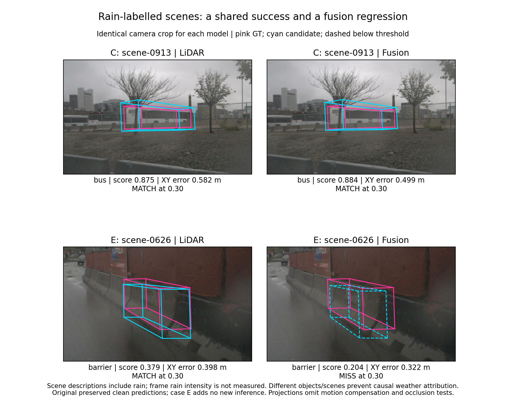

# Diagnostic extension and real rain-labelled cases — 28 October 2026

This extension answers two distinct questions: whether selected-object recovery is accompanied by wider frame improvements, and whether fusion succeeds consistently in scenes described as rainy. All calculations use preserved predictions and inputs; no GPU inference was performed.



## Findings supported by the preserved records

### 1. Case B recovery is limited

At score 0.30, considering **eight classes only**, clean fusion yields 14 true positives, 3 false positives and 24 misses. Half-brightness yields 15/3/23; quarter-brightness yields 12/2/26. LiDAR clean yields 21/2/17. Thus half-brightness produces a net gain of one match with unchanged false-positive count in these classes, while remaining below LiDAR's frame recall. Net counts do not mean that every other individual object is unchanged.

This is NOT a full ten-class frame evaluation. Bicycle and motorcycle are excluded because SDK bicycle-rack filtering cannot be reconstructed for new predictions from the supplied metadata. The same eight-class scope is used for every model and condition. Do not silently merge these values with older all-class counts.

### 2. Confidence and geometry change differently

For B's highlighted car, clean fusion -> gain 0.50 changes score 0.286743 -> 0.316402 and centre XY error 0.095702 -> 0.179738 m. Aligned size IoU improves 0.728100 -> 0.742534, while yaw error increases 1.878943 -> 2.201765 degrees. Neither a single score nor a binary match label summarises every aspect of the prediction.

`box_error_diagnostics.csv` reports all 16 nearest same-class candidates, including below-threshold candidates. These are diagnostic errors, NOT official nuScenes aggregate TP errors. Aligned size IoU compares dimensions with centres and orientations aligned; it is not full 3D box IoU. Traffic-cone yaw is deliberately not reported. Centres and angles are compared in the global coordinate system. Angle error is wrapped to [0, pi] for these directional classes.

### 3. Difficulty measurements add context without proving cause

| Case / target | Ego XY distance (m) | Raw keyframe points inside GT box |
|---|---:|---:|
| A / truck | 22.44 | 73 |
| B / car | 32.04 | 2 |
| C / bus | 35.07 | 65 |
| D / traffic cone | 19.49 | 1 |

Point counts were recomputed from the raw current LiDAR scan using saved extrinsics and ego pose, then checked against the corresponding annotation's `num_lidar_pts`; all four agree. Model input also contains nine preceding sweeps, so these are not total model-input support counts. Sparse keyframe support is a plausible difficulty indicator, not an identified cause of failure. `object_difficulty.csv` also records projected box extent in pixels: geometric extent does not measure visible object area, segmentation area or actual occlusion. Visibility tokens are absent from this transfer and remain unreported.

### 4. Rain-labelled scenes contain both successes and regressions

The existing bus C in scene-0913 is matched by both models. A newly included barrier example E in scene-0626 is matched by LiDAR (score 0.379211, XY error 0.397904 m) but falls below threshold for fusion (score 0.204313, error 0.322135 m). Again, the lower-confidence fusion candidate has the smaller centre error. Both original scene descriptions include rain. The paired figure uses the same camera image and crop for both models in each scene.

E is **additional to the four-case follow-up**, but was among the six previously preserved illustrative cases. It is not a newly sampled or independent evaluation. Its first highlighted CAM_FRONT barrier (GT index 0) was already documented in the previous annotation records. This choice reuses an existing focal object rather than searching for a new dramatic failure.

These scenes differ in class, distance, geometry and other context. They illustrate outcomes in rain-labelled scenes and cannot isolate a causal rain effect. Rain intensity is not quantified. Night-condition analysis remains pending: none of the saved 20 candidate descriptions is night-labelled. Absence of a night label is not evidence that a scene is daylight.

### 5. Relation to the larger study

The separately preserved 600-frame darkening study reports mAP x100 of 68.1300, 67.2352 and 64.5150 at gains 1, 0.50 and 0.25 respectively, and NDS x100 of 71.2886, 70.8179 and 69.1982. Source: the repository's `image_darkening/20261015/README.md`, with original metrics preserved there. These four follow-up cases are outside that frozen 600-frame sample. B's local improvement therefore neither contradicts nor constitutes a component-level decomposition of those aggregate results. The correct synthesis is heterogeneous individual responses alongside aggregate degradation on a different, predefined sample.

## Reproduction

First restore the original analysis export with the parent folder's `verify_and_prepare.py` and regenerate the parent's results with `analyse.py`. Extract the preserved `input/prepared/reference/nuscenes_six_case_annotation_inputs.zip` into a private `reference` directory, keeping its original internal layout. Point `--reference` to the directory containing `candidate_contexts.json`. Then run:

```bash
python extension/extend_diagnostics.py --input input --reference reference --output extension/results
python extension/build_rain_comparison.py --reference reference --output extension/results
```

`extend_diagnostics.py` uses the trusted, previously hash-verified project annotation pickle. Do not substitute an untrusted pickle. Source provenance and archive hashes are in the parent analysis folder. Individual rain comparisons use the original preserved clean predictions; the four-case darkening tables use the fresh follow-up predictions. These sources must not be silently pooled as numerically identical.

## Remaining essentials

- Recover the original sample annotations, visibility tokens and bicycle-rack boxes before exact all-class frame filtering.
- Search the full validation scene metadata for suitable verified night/low-light cases, then check raw sensor availability and saved predictions. No new inference is justified until those checks identify a gap.
- Preserve any new selection rule before running further comparisons. Case studies explain selected behaviour; they do not establish prevalence or weather causality.
