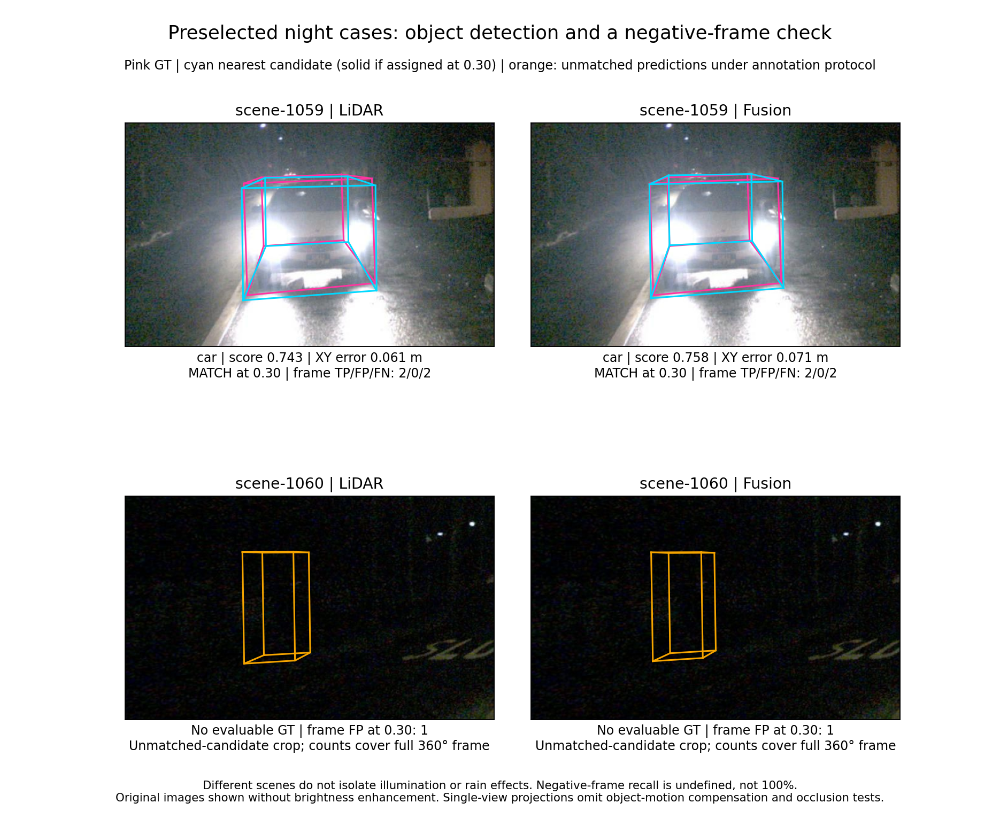

# Two preselected night cases — 28 October 2026

This CPU study adds real night-labelled cases to the earlier controlled synthetic-darkening analysis. The two frames were selected from scene metadata before inspecting their predictions: the middle timestamped validation frame in each of the first two alphabetically ordered night-labelled scenes. They were not selected for a gain or a regression. Focal objects and camera crops follow the documented rules below. No new inference was performed.



## Frame results at score 0.30

All ten detection classes; local score-ordered one-to-one matching at XY centre distance <2 m, after class-range, zero-GT-point and bicycle-rack filtering. These are diagnostic counts, not official nuScenes AP/NDS.

| Frame | Original scene text | Evaluable GT | LiDAR TP / FP / FN | Fusion TP / FP / FN |
|---|---|---:|---|---|
| scene-1059 | Night, residential, car turning | 4 | 2 / 0 / 2 | 2 / 0 / 2 |
| scene-1060 | Night, rain, turn, ped in dark | 0 | 0 / 1 / 0 | 0 / 1 / 0 |

## Scene-1059: detection success and missed objects in the same frame

The highlighted nearest car is at ego XY distance 9.54 m, visibility band 80–100%, with 147 annotated current-scan LiDAR points. Both models match it: LiDAR score 0.743353 / XY error 0.060766 m; fusion 0.757523 / 0.071350 m. Fusion has a slightly larger score and larger centre error. This single comparison does not establish model superiority.

The frame also contains two farther cars missed by both models at threshold 0.30:

| Car distance (m) | Annotated visibility | LiDAR points | LiDAR score | Fusion score | At 0.30 |
|---:|---|---:|---:|---:|---|
| 9.54 | 80–100% | 147 | 0.743 | 0.758 | Both match |
| 15.87 | 80–100% | 110 | 0.436 | 0.517 | Both match |
| 28.45 | 0–40% | 4 | 0.146 | 0.106 | Both miss |
| 33.43 | 0–40% | 7 | 0.296 | 0.080 | Both miss |

Scores shown are nearest same-class candidates. Matching is separately checked by assignment; a nearby candidate is not automatically a match. At threshold 0.10, LiDAR recovers all four GT cars with one FP, while fusion recovers three with no FP. At 0.50, LiDAR retains one match and fusion two, with no FPs. Thus the apparent operating-point comparison changes with threshold. No threshold is optimised or recommended from these cases.

Distance, visibility and point support differ together across these four objects. They provide measured difficulty context, not evidence identifying the causal effect of darkness or any single factor. Annotation visibility bands are not brightness measurements or per-camera segmentation measurements. Current-scan point counts do not include the nine preceding sweeps used by the models.

## Scene-1060: an annotation-negative frame, not a pedestrian-detection success

Although the scene description includes “ped in dark”, the selected frame has only three `movable_object.pushable_pullable` annotations and no annotated objects in the ten detection classes. Scene-level descriptions must not be promoted to frame-level object labels. Recall is undefined here; it is not 100%.

At threshold 0.30, each model returns one pedestrian prediction unmatched under the supplied annotations: LiDAR score 0.489323, fusion 0.476350. Both predictions fall below 0.50. They are counted as FPs under the annotation/evaluation protocol. The annotations and dark image alone do not prove physical absence of a person, annotation completeness, or a hallucination mechanism. This case warrants annotation/image scrutiny before attributing a physical false alarm to either model. No labels were edited.

The two unmatched candidates are close spatially, but neither shared candidates nor similar scores establish why they arose. The nearest excluded-category annotation is approximately 24.9 m away from the LiDAR candidate centre; there is no direct centre alignment supporting a simple claim that it is one of the recorded pushable objects.

## Figure selection and interpretation

For a positive frame, the focal rule uses GT only: nearest eligible pedestrian, else nearest eligible car, else nearest other detection-class GT; ties use annotation token. A camera must have the full 3D box in front of it and positive clipped projection area. The camera with largest clipped GT projection area is selected; both models use the same crop. In scene-1059 this selects CAM_BACK and the nearest car.

For the annotation-negative frame, the view is explicitly outcome-informed: show the highest-score LiDAR candidate >=0.30 in the camera with the largest clipped projected area, and share that camera and crop across models. This is an editorial choice to visualise an unmatched candidate, not an outcome-based change of frame selection. It selects CAM_BACK. All frame counts cover 360 degrees, not only the displayed view.

Original images are shown with no brightness enhancement. Pink denotes GT, cyan the nearest same-class positive-case candidate, orange the negative-case unmatched predictions. Camera projections use original calibration and camera-time ego pose; no object-motion compensation or occlusion test is applied.

## What this adds to the project

The four-case synthetic-darkening study controls image-value gain on identical frames. This study supplies original night images, object-level difficulty measurements, and an annotation-negative case that exposes the limits of scene descriptions and detection labels. Together with the real rain-labelled examples, it strengthens the critical case narrative without claiming a causal weather comparison.

There are only two preselected frames from related acquisition-log prefixes. Scene-1060 combines night and rain, and scene-1059's lack of a rain word does not establish dry conditions. Do not report representative night/rain accuracy, independent recording conditions, weather-effect estimates, a safety guarantee or robotics deployment performance from these cases. No matched day/night repetition of an identical scene is available here.

The current scope includes one positive night frame and one annotation-negative night/rain frame. It does NOT include a labelled positive pedestrian test under night rain. If that becomes an essential supervisor requirement, select an additional frame by a documented annotation-based rule before reviewing model predictions; keep the present two cases and report the amendment.

## Preservation and reproduction

Original full prediction files were verified against the preserved merge hashes before subsetting: LiDAR `15667405cb1af580e6f8082dcc50366560e45335c36f7122ec490f377cd86c63`, fusion `dcd86893985366881b27d3841b64b93a85988158b518f0c9edfa274c291596dd`, with exact 6,019-token inventory agreement. Source archives were hash-verified during transfer. The input ZIP SHA-256 is `e09b902bc7be114021d435c9720c5223947fd9d4b9c74c016c320f5fe3d20f3d`; all 21 payload sizes/hashes were checked after upload. Those checks establish provenance, not new inference or an independent evaluator implementation.

The public folder excludes raw sensor payloads. They remain in the verified Drive transfer and private evidence bundle, subject to the original dataset licence. With the original input ZIP supplied separately:

```bash
python verify_inputs.py --archive source_inputs.zip --output input
python build_night_analysis.py --input input --output results
```

Install the versions in `requirements.txt`. Derived tables include all 12 frame/model/threshold rows and all eight GT-object/model records from the positive frame. `matching_details.json` preserves assignments, unmatched predictions and filter counts; `focal_selection.json` states the selection rules. Neither a true-negative rate nor AP/NDS is calculated.

The UTF-8 reader used for Colab recovery was corrected after a streaming-TAR compatibility failure and tested against a multi-chunk Unicode streaming-TAR fixture. No predictions or sensor contents were changed by that repair.
