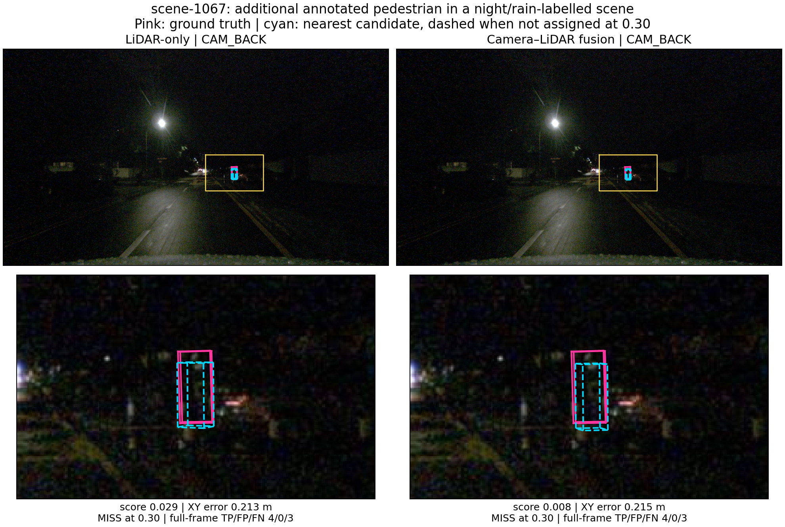

# Additional positive night/rain pedestrian case: frozen preparation plan

**Status: input ZIP verified, original images reviewed and additional positive-frame diagnostics complete.** The selected pedestrian is missed by both models at all three predeclared thresholds. This closes the specific annotation-positive night/rain case gap; it does not establish representative weather accuracy. No new inference was performed.

## Result: a shared low-score miss in scene-1067

The frozen annotation-based rule selected sample `28e33ad25c0943b49b57f8f1346d5bd2` in **scene-1067**, described as “Night, rain, bump, ped in dark, arrive at intersection.” The preserved audit contains three night/rain-labelled candidate scenes: 1060, 1065 and 1067. Neither earlier scene contains an eligible pedestrian frame under the declared rule; 1067 contains 22 eligible frames. The selected frame is the eligible one nearest the scene's middle timestamped validation frame. The ranking rule was replayed from the preserved candidate audit; the full source annotation archive was not independently rescanned in this local analysis.

There is one eligible annotated pedestrian at **30.0595 m**, with visibility band **80–100%**, **one current-scan LiDAR point** and zero current-scan radar points. The LiDAR point count was recomputed from the raw scan using the saved transforms and agrees with the annotation. The model also uses nine preceding sweeps, so one point is not the total model-input support. GT-only projection selects **CAM_BACK**, with a projected box extent of approximately **23.9 × 48.8 pixels**. This is geometric extent, not a measured visible silhouette. The original unenhanced image is dark and the object is difficult to identify from the crop alone; the positive label comes from the supplied annotations.

| Pipeline | Nearest pedestrian score | XY centre error (m) | Focal match at 0.10 / 0.30 / 0.50 | Full-frame TP / FP / FN at 0.30 |
|---|---:|---:|---|---|
| LiDAR-only | 0.029148 | 0.212734 | Miss / miss / miss | 4 / 0 / 3 |
| Camera–LiDAR fusion | 0.008018 | 0.214623 | Miss / miss / miss | 4 / 0 / 3 |

Both pipelines have nearby pedestrian candidates, but none within 2 m is score-eligible even at 0.10. The failure is therefore a score-exclusion outcome under this local matching rule, not absence of a nearby same-class candidate. These scores are not calibrated probabilities. At 0.10, LiDAR introduces one unmatched prediction while fusion has none; both still have four frame matches and miss this pedestrian. No new threshold was searched or recommended. At 0.30, the same four GT identities are matched by both pipelines.

**Caption.** Additional annotation-selected positive night/rain frame, scene-1067. Columns compare separately pretrained LiDAR-only and camera–LiDAR pipelines using identical original CAM_BACK images and GT-selected crops. Pink denotes projected GT; cyan denotes the nearest same-class candidate, dashed when unassigned at score 0.30. Top panels give the complete camera view; yellow outlines locate the enlarged lower crops. Original image values are unchanged. Counts cover the entire 360-degree frame, not just CAM_BACK. Projections use recorded calibration and camera-time ego pose, without object-motion compensation or occlusion tests. Confidence/centre-distance diagnostics do not establish full 3D-box quality or weather causality. [Vector PDF](results/pedestrian_comparison.pdf).

## Critical interpretation

This is an annotation-positive frame, not a successful pedestrian detection. It complements scene-1060, whose selected night/rain frame has no eligible ten-class GT and cannot support positive pedestrian recall. Keep both results: they answer different questions. Here the annotation supports evaluation of a real labelled target, and both tested pipelines fail at all predeclared operating points.

High annotated visibility does not imply a bright, large or readily recognised target in a particular camera image, and sparse current-scan support does not isolate a cause. Distance, low image brightness, geometry, model training and multi-sweep support remain competing explanations. Rain and darkness occur together; no matched dry/day counterpart, measured rain intensity or controlled physical-weather intervention is supplied. The three night frames share an acquisition-log prefix. This extra frame is not an independent representative night/rain benchmark or a physical safety test.

The supported contribution is a reproducible shared failure case selected without inspecting model outcomes, with explicit annotation, input-support, confidence and whole-frame evidence. A plausible next research question concerns score calibration or stronger far-pedestrian evidence, but no remedy was tested. The intended next activity is dissertation integration, not another experiment campaign.

## Evidence and reproduction

- [Pedestrian threshold diagnostics](results/pedestrian_threshold_diagnostics.csv) and [ten-class frame diagnostics](results/frame_threshold_diagnostics.csv): six rows each.
- [GT-only focal/camera selection](results/focal_selection.json), [assignments and filter counts](results/matching_details.json), [analysis audit](results/analysis_audit.json).
- [Frozen frame selection](frozen_selection.json), [candidate selection audit](selection_audit.json), [source verification](source_verification.json), [input hashes](input_manifest.json), [import audit](import_audit.json).
- [Analysis code](analyse_case.py) and [executed dependency versions](requirements.txt). With the original private input ZIP supplied separately, run `python analyse_case.py --archive source_inputs.zip --output regenerated_results`.

The uploaded 1,728,550-byte archive SHA-256 is `1dcdef345a25febf7352cc393e06629e65c7935d4b4fd0fa3a47cd46b3a8ca97`; all 18 payload sizes/hashes pass. Original inputs and saved predictions have a verified Colab/Drive receipt. Derived figures/tables are published here; their later Drive-copy execution remains separate. Original sensor payloads and raw prediction subsets are excluded from this public folder.

## Original preparation protocol and repair history

The original night study contains one positive car frame and one annotation-negative night/rain frame. This bounded amendment adds one annotation-positive pedestrian frame while retaining both original examples. It addresses that specific evidence gap before dissertation writing resumes; it is not a new broad benchmark or training campaign.

## Selection fixed before predictions

The [protocol](selection_protocol.json) defines a deterministic rule:

1. Restrict to official validation scenes explicitly labelled night/nighttime and rain/rainy/raining in scene descriptions. These remain scene-level context, not measured frame-level weather intensity.
2. Require six camera keyframes and the current LiDAR keyframe in the preserved, hash-verified part-10 backup. This is an availability restriction, not random sampling.
3. Require an annotated pedestrian in one of the four official detection categories, with combined annotated LiDAR/radar support greater than zero and ego XY distance strictly below 40 m at the LiDAR keyframe pose.
4. Use the first scene alphabetically containing an eligible frame. Within it, choose the eligible frame nearest the middle timestamped validation frame; break ties by sample token.
5. Preserve the protocol, candidate audit and frozen frame selection on Drive before opening either model's predictions. If there is no eligible frame, stop without silently relaxing the rule.

Later visual selection uses the nearest eligible pedestrian with a valid camera projection, and selects the camera with the largest clipped GT projection. This also avoids model-outcome selection. Both models share the image/crop. Retain the existing local filters, one-to-one XY <2 m matching and thresholds 0.10/0.30/0.50; 0.30 remains primary. No threshold optimisation is planned.

## Preparation and required handoff

Run [prepare_inputs_colab.py](prepare_inputs_colab.py) in CPU Colab with the existing Drive mounted. It needs the original metadata backup, preserved part-10 keyframes and both full-validation prediction files at the already recorded paths. All source hashes are checked. It streams original metadata, applies the frozen selection, extracts only seven sensor keyframes and the selected saved predictions, then preserves and verifies a compact ZIP and receipt on Drive. The JSON-array reader uses a tested UTF-8 streaming reader compatible with streaming TAR members.

That preparation handoff has now completed; the ZIP supplied the analysis above. Preparation success does not establish a model match, pedestrian visibility in a chosen crop, or positive weather robustness. No additional sweeps, package installations, model loading or GPU inference are required for this saved-prediction analysis.

Expected preparation marker: `POSITIVE_NIGHT_RAIN_INPUTS_AND_DRIVE_COPY_PASS`. [Local synthetic preparation checks](preparation_checks.json) cover selection boundaries, tie-breaking, missing-file exclusion and a multi-chunk Unicode streaming-TAR fixture; those checks describe the preparation stage; actual dataset execution and local analysis have since completed.

## Completion boundary

Source/input checks, original-image review, eligible/projectable pedestrian confirmation, paired matching, the compact figure/table and bounded discussion are complete and preserved in this repository. A later copy of the derived outputs to Drive is not certified by the earlier input-transfer receipt. Keep any failure or unexpected outcome; do not search for a more favourable prediction. If the selected inputs cannot support the planned pedestrian view, record that limitation before agreeing any amendment.

One selected positive example will complement the existing cases. It cannot establish representative night/rain accuracy, independent recording conditions, weather causality or physical robot safety. After this bounded addition, the intended next work is dissertation integration rather than an expanded experiment list.

## Inventory repair and same-runtime recovery

A real inventory exposed an earlier LiDAR keyframe among historical sweep inputs under `samples/LIDAR_TOP/`. Five candidate inventories contained two `samples/` paths. The initial helper incorrectly required exactly one such path. This stopped preparation before predictions were accessed.

The corrected helper resolves current keyframes from `sample_data`: sample token must match the inventory frame and `is_key_frame` must be true. It checks all six camera channels and exactly one current LiDAR record, irrespective of inventory order. The original inventory is retained separately; the compact transfer inventory includes only the resolved current LiDAR scan. The frozen annotation-based scene/frame criteria are unchanged.

`main(resume_state=...)` accepts the retained pre-selection locals from the failed run, checks the preserved protocol and stage, and reuses the source-archive hash checks completed in that runtime. It does not present these as fresh archive rehashes. Metadata scanning resumes from the annotation/sensor-data stage, then verifies both full prediction hashes before extracting the selected results. A repair record is included in the transferred ZIP.

[Repair checks](inventory_repair_checks.json) include a historical-keyframe regression, missing/ambiguous metadata rejection, Unicode streaming-TAR parsing and an end-to-end synthetic retained-state packaging run. These are local fixtures; the later real Colab recovery and local analysis are recorded above. If retained runtime state is missing, stop rather than skipping source validation.
