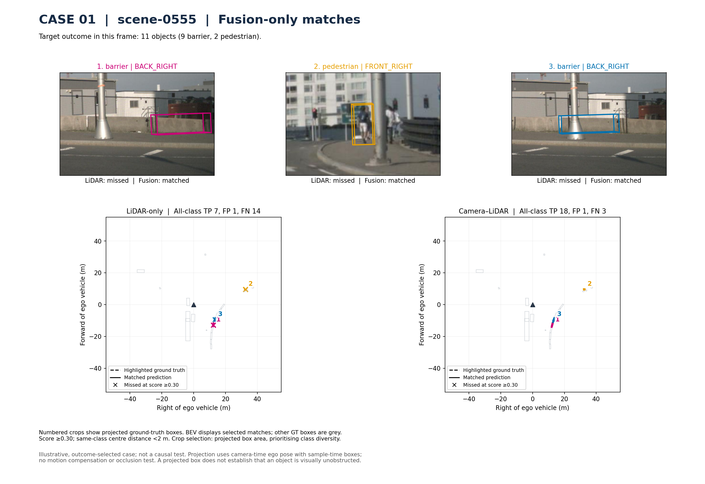
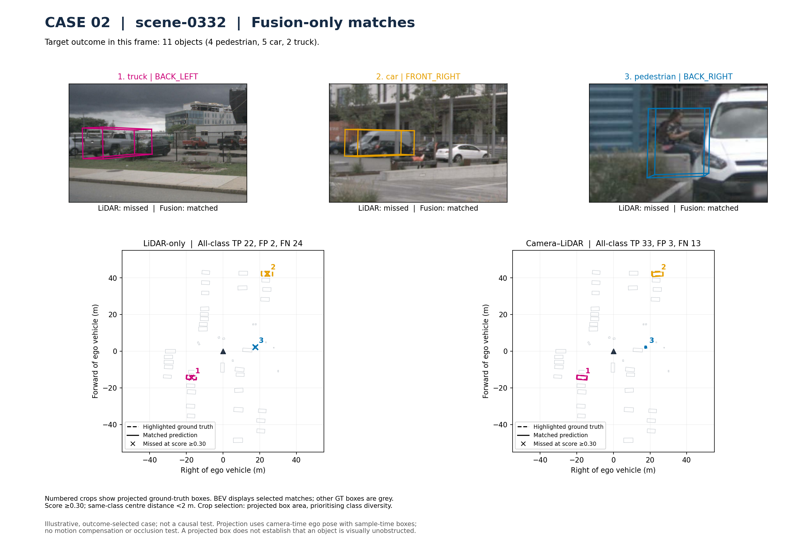
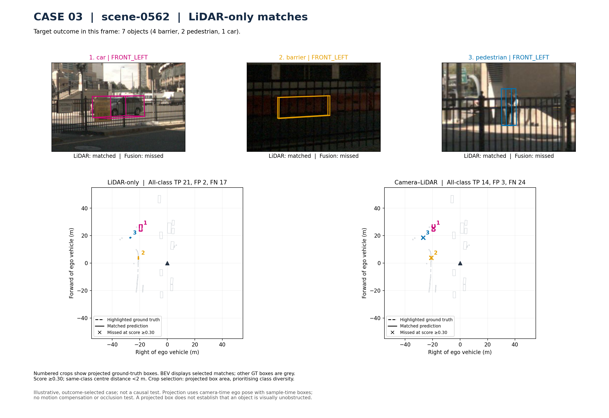
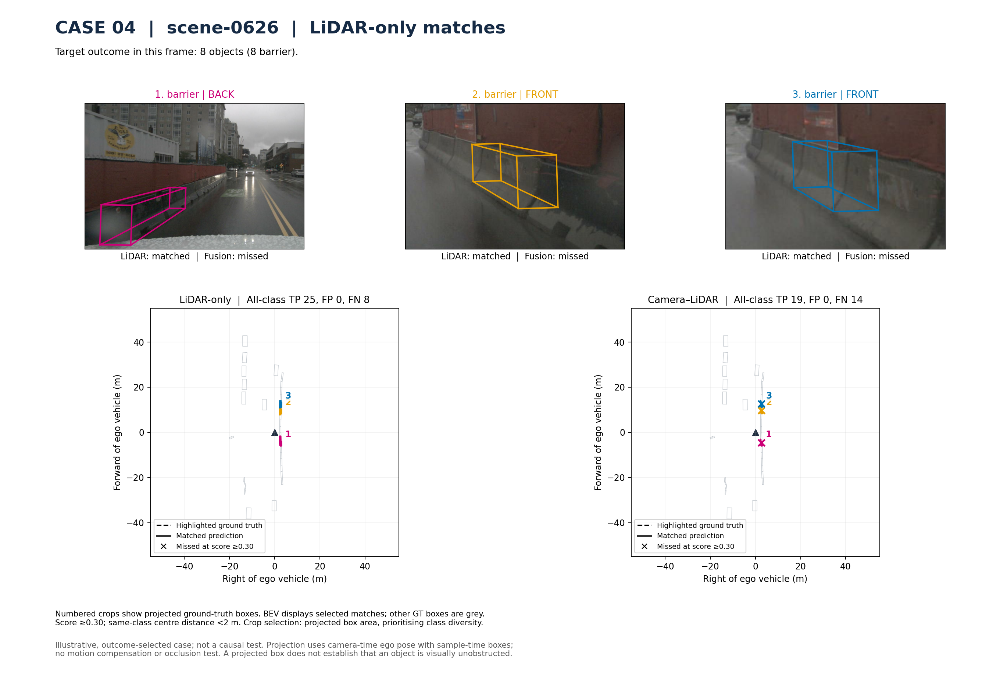
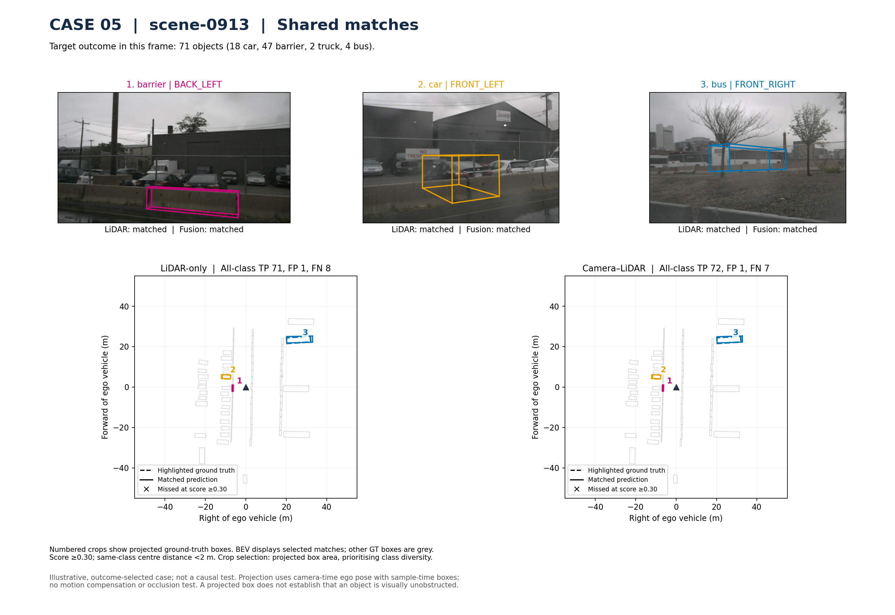
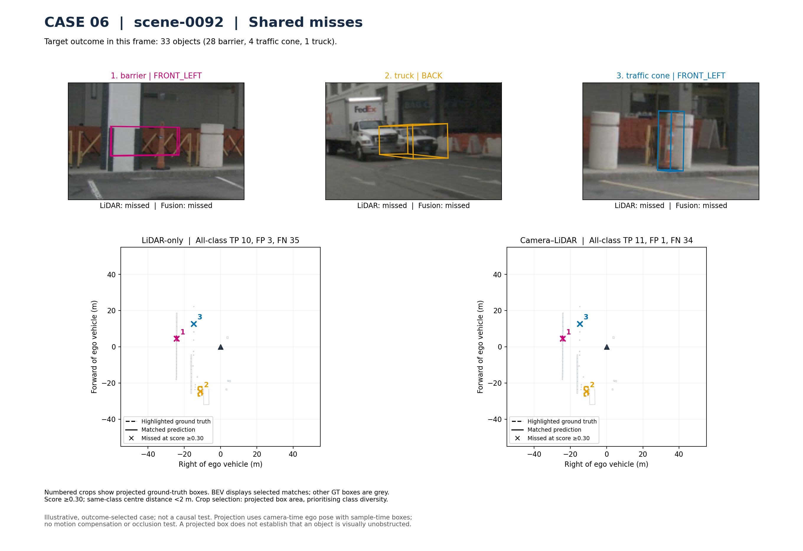

# Annotated nuScenes case studies

Six selected illustrations from the full-validation predictions. These show fusion gains, regressions, shared successes and shared misses at confidence ≥0.30 and a same-class centre-distance threshold <2 m. They are not a representative robustness evaluation, and visible conditions do not establish error causes.

[Captions, selection method and limitations](annotated_cases/README.md) · [Object records](annotated_cases/annotation_records.json) · [Plotting code](annotated_cases/build_six_figures.py) · [SHA-256 manifest](annotated_cases/manifest.json)

