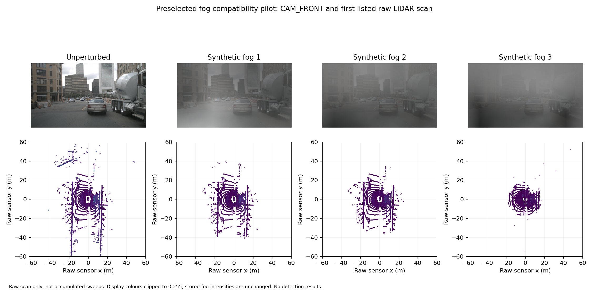

# Bounded synthetic fog study — 29 October 2026

## Status

Real preflight and CPU corruption compatibility are complete. All 9,600 required sensor paths are available by filename and all 16 preselected pilot files were recovered. Uploaded ZIP SHA-256 `9fd0f95619b8e4d19ef9a4c6432e332a90d75281c3a303159e76581bdb6a8126` (5,161,010 bytes) and all 31 payload hashes pass. Raw inputs remain private. The real T4 setup/build and LiDAR pilot forwards at levels 0/1/2/3 succeeded. The paired smoke stopped at the fusion baseline repeat check (4/200 label positions differed); the subsequent diagnostic reproduced depth-map variation and exact baseline repeats under strict determinism. The amended paired all-condition rerun is pending. No 600-frame fog accuracy result exists yet. See [verified first-attempt evidence](smoke_attempt_1/import_receipt.json) and the diagnostic below.

## Completed CPU compatibility checks

[CPU validation](cpu_validation/cpu_validation.json) and [all 48 real-input checks](cpu_validation/pilot_checks.csv) compare the adapter against hash-verified upstream function definitions on the fixed first frame. All 18 full-resolution camera cases match exactly after uint8 conversion; all 30 raw LiDAR cases match exactly after float32 conversion. Three synthetic range-boundary/zero-radius cases also match. Repeatability, unperturbed identity, caller RNG preservation, source-input immutability, finite output, fifth raw-feature preservation and clean/fog PNG round-trips pass. Four additional helper checks include annotation-path ambiguity rejection and a synthetic 600-row annotation reduced to the same pilot without changing non-path geometry.

The adapter vectorises the final camera pixel loop and LiDAR response loop; source fractal generation, lookup bins, numerical operations and RNG draw sequence are retained. Exact equality is demonstrated on these inputs, not proved universally. Deterministic seeds are SHA-256 of UTF-8 `20261029:fog:{camera|lidar}:{severity}:{relative_path}`, first eight bytes unsigned big endian; camera uses this modulo 2^32 with legacy NumPy MT19937, LiDAR uses PCG64. Severities are independently seeded; each raw file/level is shared between pipelines.

Both unperturbed and fog camera caches use lossless PNG after pinned OpenCV decode. This preserves the RGB uint8 arrays and avoids an additional JPEG re-encoding confound. The upstream converter stores JPEG for these filenames, so this is an explicitly documented benchmark-inspired implementation, not a bitwise reproduction of the released MultiCorrupt dataset. Original image geometry and downstream augmentation remain fixed.

Local median per-image reference/adapter times were 5.975/0.611 seconds; raw-scan times were 0.259/0.00389 seconds. These are local pilot preparation timings, not GPU model latency, full-study wall time or a reproducible hardware benchmark. Upstream numerical behaviour is retained: maximum observed pilot fog intensity is 520.528 (no extra 255 clipping), and up to three output points per tested scan/condition lie beyond 200 m. Finite-output checks pass; these observations reinforce the synthetic-model limitation. Display colours alone are clipped for the figure.

[Figure PDF](cpu_validation/pilot_fog_comparison.pdf). This shows CAM_FRONT and the first listed raw scan, not accumulated sweeps or detection outcomes. Figure layout was visually reviewed.

The preceding [natural-weather CPU study](../../weather_groups/20261028/completed/README.md) is complete. This is a separate controlled synthetic intervention on the previously frozen 600-frame / 150-scene challenge subset, not another natural-weather stratum.

## Study design

The embedded design in [preflight_fog_colab.py](preflight_fog_colab.py) is saved and verified on Drive before input inspection. Its pilot rule is fixed: first token in the unchanged ordered challenge token list, all six camera files and all ten listed LiDAR input files. Never substitute another frame based on availability or outcomes. Historical sweeps can live under `samples/LIDAR_TOP/`; a path prefix or count cannot identify the current scan. The full model annotation/metadata will resolve that later.

Planned conditions are unperturbed plus fog severities 1/2/3 for each pipeline: **two fresh baseline runs and six fog runs**. Checkpoints, detector source commit, input population, calibration, GT and evaluator stay fixed. Original unperturbed scenes may already contain natural rain/night; unperturbed does not mean clear weather. This compares two existing separately pretrained pipelines and does not isolate the camera component causally.

## Published method and implementation boundary

Source: [MultiCorrupt, official author repository](https://github.com/ika-rwth-aachen/MultiCorrupt/tree/39652e35d10dd7c2aed0b71df8c8c7effe9e6349), pinned commit `39652e35d10dd7c2aed0b71df8c8c7effe9e6349`. Its [MIT licence is retained with this adapter](MULTICORRUPT_LICENSE.txt). The preflight downloads four source files, three lookup tables and the licence, verifying their exact Git blob hashes. Assets are not executed/deserialised in this stage.

- LiDAR source `simulate_fog` applies hard-target attenuation and soft fog responses using lookup tables. Severity alpha/beta pairs are (0.02, 0.008), (0.03, 0.008), (0.06, 0.05); converter calls use noise=10, default noise variant v1 and no gain. The converter loads raw float32 Nx5 scans, also corrupts all preceding sweeps when enabled, then stores float32 output. Apply this before scan-coordinate transformations, sweep aggregation, voxelisation and fusion depth construction. Preserve the fifth raw feature and subsequent loader time-lag construction.
- Camera source `fog` combines fractal haze with a spatial distance heuristic, using beta 0.0005/0.001/0.002. The converter decodes raw-resolution BGR images, converts to RGB, then applies the effect before output encoding. It is not a depth-calibrated atmospheric reconstruction.
- Camera and LiDAR severity indices are benchmark settings, not a shared physical visibility distance. Report a synthetic benchmark fog challenge rather than verified real-fog robustness or a physically calibrated joint atmosphere.
- The upstream code uses legacy `np.float_` and `pickle5`, global RNG state and per-pixel/per-point loops. These are compatibility, reproducibility and preparation-time issues to test. Do not silently change arithmetic, coordinate frames, noise handling or intensities for speed. Any accelerated/adapted implementation must be checked against the pinned reference and documented before full inference.

RNG mapping, lossless encoding and acceleration have now passed the bounded CPU checks above. The GPU launcher preserves a follow-on implementation protocol on Drive before inference, including those choices and fixed smoke acceptance rules. Population, pilot-selection rule and published severity levels remain unchanged.

## CPU preflight procedure

Use the standard-library script with Drive mounted; CPU is sufficient. It:

1. Preserves the design on Drive, downloads the pinned existing token list and sensor inventory, and verifies the same 600 tokens / 150 scenes / 9,600 unique referenced files.
2. Selects the first frozen token without accessing predictions or GT outcomes.
3. Downloads/verifies the pinned upstream assets without executing them.
4. Checks known extracted sensor roots and a bounded catalogue of project ZIP files (at most 32 ZIPs; project folder and relevant descendants only). Reads central directories for filename availability; does not expand nested TARs or rehash multi-GB archives. Reports skipped/unexpanded sources explicitly.
5. Recovers available pilot files from extracted data or direct ZIP members. ZIP reads check CRC, and recovered bytes get SHA-256 hashes. Filename availability is not full content verification; all complete study inputs must pass their preserved content checks before inference.
6. Records installed package metadata and `nvidia-smi` output when available. No package installation, torch/model import, GPU inference, corruption or environment changes.
7. Produces a manifest-verified private ZIP and hash-verified Drive copy, whether the pilot is ready or missing files. Upload it for source-equivalence testing and the next restoration/runtime step.

Arguments: `--base` preserved project directory, `--work` local work parent, repeatable `--sensor-root` for an existing extracted input root. No need to enable GPU for this step. The pilot input ZIP contains raw sensor data and must remain private; only derived checks/figures will be published.

## Checks and next gates

Run `python check_preflight.py`. Four checks cover complete populations, historical keyframes under `samples/`, malformed sensor counts, safe/ambiguous ZIP indexing, bounded project catalogue, and a synthetic 600-frame / 150-scene transfer with 16 recovered pilot files, pinned opaque assets, no deserialisation and verified output members. These are handoff checks, not fog arithmetic validation.

The real CPU validation is reproducible with `validate_fog_pilot.py PREFLIGHT_ZIP --output NEW_DIRECTORY` in NumPy 1.26.4 / OpenCV 4.11.0 / Python 3.10.22; the report records source hashes. Run `check_fog_adapter.py --pilot EXTRACTED_PRIVATE_PILOT_DIRECTORY` for the four state/path/annotation preparation checks. Those additional checks use real pilot pixels/scans with synthetic annotation geometry and do not evaluate a detector.

## Next: one-frame GPU smoke

[run_fog_gpu_smoke_colab.py](run_fog_gpu_smoke_colab.py) requires a Colab GPU runtime (T4 is the previously used GPU) and mounted project Drive. Pass its full published `--code-commit`. It verifies the exact pilot ZIP and published source blobs, preserves the implementation protocol before inference, freshly hashes the original pilot source archive against its known SHA-256, and rechecks the 16 source members. It restores the exact 600-row Kaggle annotation export (SHA-256 `4f11db818b8d5504fc2bb432fcd51a28b09fec8d0b9c4063f2a017413fbfa99d`) and constructs only a one-frame derivative for each smoke condition. Other annotation fields are recursively checked unchanged.

[setup_fog_gpu.py](setup_fog_gpu.py) adapts the project's previously exercised isolated stack: Python 3.10.22, PyTorch 2.1.2+cu121, MMCV 2.1.0, MMDetection 3.2.0, MMEngine 0.10.7, spconv-cu120 2.3.6, cumm-cu120 0.4.11 and detector source commit `fe25f7a51d36e3702f961e198894580d83c4387b`. It installs GCC/G++ 11 if missing, selects them through local compiler aliases, downloads the hash-verified CUDA 12.1 toolkit installer into the isolated folder, builds BEVFusion operations, and executes the preserved CUDA NMS/pooling/voxel checks. Only the toolkit is installed; no GPU-driver installer option is used. [NVIDIA documents the custom toolkit installation option](https://docs.nvidia.com/cuda/archive/12.1.0/cuda-installation-guide-linux/#runfile-installation); this does not establish official support for every future Colab host. Actual build/operation checks must pass in the user's GPU session.

The [smoke worker](fog_gpu_smoke.py) prepares all six lossless camera inputs and all ten raw scans at levels 0/1/2/3; retains nine historical sweep records and current scan identity from the original annotation; strictly loads both hash-verified checkpoints; and forwards each condition. It checks valid finite boxes/scores/labels, clean repeat agreement and equal packed point tensors between models per condition. There are eight distinct one-frame model/condition forwards plus a clean repeat for each model. No GT AP/NDS is computed and output counts are not a performance acceptance criterion.

GPU setup downloads/builds can take substantially longer than the actual one-frame forward passes. The real T4 setup/build and CUDA operation checks have now run successfully, and LiDAR passed all four conditions. The paired smoke has not passed: fusion stopped on the baseline repeat assertion. Any failure stops the workflow and preserves logs in a manifest-verified Drive ZIP. Success similarly preserves only code/configuration, audits and pilot predictions; raw sensors, annotation pickles, environments and checkpoints are excluded from the evidence ZIP. Full 600-frame input-content verification, eight full inference runs and unchanged CPU evaluation follow after smoke evidence review. Snow and natural disasters remain outside this measured extension unless explicitly added later.

## Fusion repeat diagnostic after first GPU attempt

The uploaded first-attempt ZIP (169,178 bytes, SHA-256 `5891509e3160a49f052bfed701a24ccc99e82bd6bd7150da9c14478438fbf189`) passes exact member-set, CRC, size and SHA-256 checks for all 31 payloads. The fresh original-archive hash and 16 pilot-member rechecks passed in Colab. LiDAR produced 200 predictions at each level and its original positional clean-repeat gate passed. Fusion loaded the complete checkpoint strictly and reached baseline prediction, but 4/200 label positions differed on repeat. This does not establish four changed physical objects: the original worker stopped before preserving either fusion prediction array. Ordering alone, numerical variation and upstream execution differences remain hypotheses.

The pinned upstream [depth projection](https://github.com/open-mmlab/mmdetection3d/blob/fe25f7a51d36e3702f961e198894580d83c4387b/projects/BEVFusion/bevfusion/depth_lss.py) assigns projected distances to indexed pixel locations. PyTorch 2.1 [documents undefined behaviour for duplicate indices with non-accumulating indexed assignment](https://docs.pytorch.org/docs/2.1/generated/torch.Tensor.index_put_.html). This motivates inspecting projected depth, but neither duplicate collisions nor their contribution to this failure have yet been demonstrated on the pilot.

[diagnose_fusion_repeat_colab.py](diagnose_fusion_repeat_colab.py) reuses the existing session, caches and checkpoints. It verifies the preserved failed ZIP and local payloads, baseline sensor hashes, original annotation/checkpoint/source identity, and unchanged baseline annotation geometry/paths. It saves a diagnostic protocol to Drive before execution. It runs three baseline forwards on deep copies of one packed input in each of two separate subprocesses: original default determinism and strict PyTorch deterministic algorithms (warn_only=False, cuBLAS workspace fixed before import). Repeated dataset reloads are fingerprinted. Hooks measure projected-depth, view-transform, LiDAR-branch and fusion-feature differences; all repeated prediction arrays are saved.

The diagnostic reports both original positional agreement and permutation-aware set correspondence using the original box/score tolerances and exact classes. The latter is diagnostic, not an amended smoke gate. No source code, caches, fog severity, selection rule or checkpoint is changed. A strict-mode exception is retained rather than bypassed. Both mode return codes must be reviewed: a preserved diagnostic ZIP is not a smoke success. Six CPU checks cover the comparison helper; no diagnostic GPU execution has been performed locally. After identifying the cause, any necessary execution-protocol amendment must be documented and the paired smoke must pass before full fog inference.

## Verified repeat diagnostic and strict-determinism amendment

The [complete diagnostic ZIP](repeat_diagnostic/fog_repeat_diagnostic_20261029T084930614337Z.zip) is 176,119 bytes, SHA-256 `4ef30b9a808cabd729edc9ada7116a800ac52b7832a94def2d7ce6d4f51565b2`. All 23 payload sizes/hashes, exact ZIP membership and CRC pass. [Independent local review](repeat_diagnostic_verified.json), reproduced by [verify_fog_repeat.py](verify_fog_repeat.py), recomputes comparisons from all six saved prediction arrays. The intermediate arrays themselves were not exported; their recorded hashes/difference summaries can be checked for consistency but cannot be reconstructed from this evidence.

Both diagnostic subprocesses completed on Tesla T4. Packed point/image/metadata inputs were identical across reloads and cloned forwards, and the CPU originals remained unchanged. Under default execution, the projected depth differed from the first forward in 5,410 and 5,124 elements (maximum absolute differences 37.6681 and 37.6994 m). The LiDAR branch features stayed exactly equal within that subprocess, while view-transform and fusion features varied. Label-position differences were 6 and 8; permutation-aware matching at the original tight tolerances did not establish equal prediction sets. These are repeatability measurements, not detection-error rates or physical-object localisation changes.

Under strict PyTorch determinism, all three baseline forwards had exactly identical projected-depth, view-transform, LiDAR-branch and fusion feature hashes. All 200 output boxes, scores and labels were also exactly equal across the three forwards. This establishes a usable same-session pilot execution setting and localises observed default variation to at least the depth-construction stage. It does not isolate one CUDA kernel, count duplicate projected indices, establish cross-hardware repeatability, or validate all fog levels. The PyTorch duplicate-index documentation remains relevant context rather than proof of the unique kernel-level cause.

[resume_fog_gpu_smoke_colab.py](resume_fog_gpu_smoke_colab.py) reuses the existing environment and all four caches. It verifies the original failed evidence, diagnostic evidence, all 64 cached sensor payloads, original annotation/checkpoints/source and compiled-extension hashes. Before inference it preserves a Drive implementation amendment: strict PyTorch deterministic algorithms with warn_only=False, cuDNN deterministic=True, and `CUBLAS_WORKSPACE_CONFIG=:4096:8` before torch import. It then executes the hash-verified original worker unchanged for each model. This preserves source/model code and numeric positional-repeat tolerances; it changes execution settings explicitly. Fresh clean/fog comparisons must use this setting consistently for both models. Historical default-execution results are retained separately.

The rerun includes baseline plus three fog levels for both models and the original additional baseline repeat per model. It checks equal packed point tensors across models at every level. No dependency installation, source edit, corruption regeneration, retraining or tolerance relaxation occurs. Local archive-helper and syntax checks pass; the strict paired rerun is prepared but has not yet been executed/reviewed. Full 600-frame inference remains pending.
