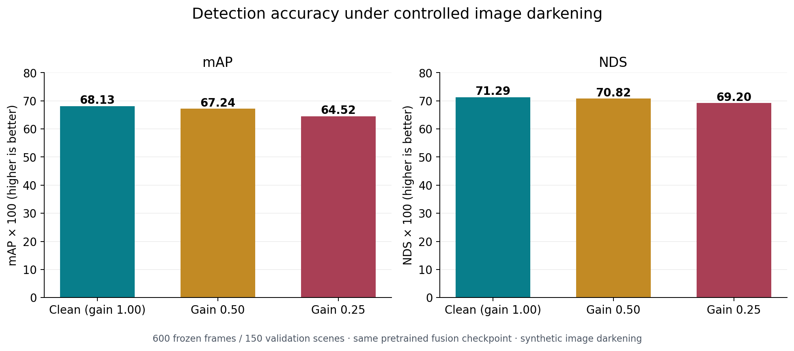
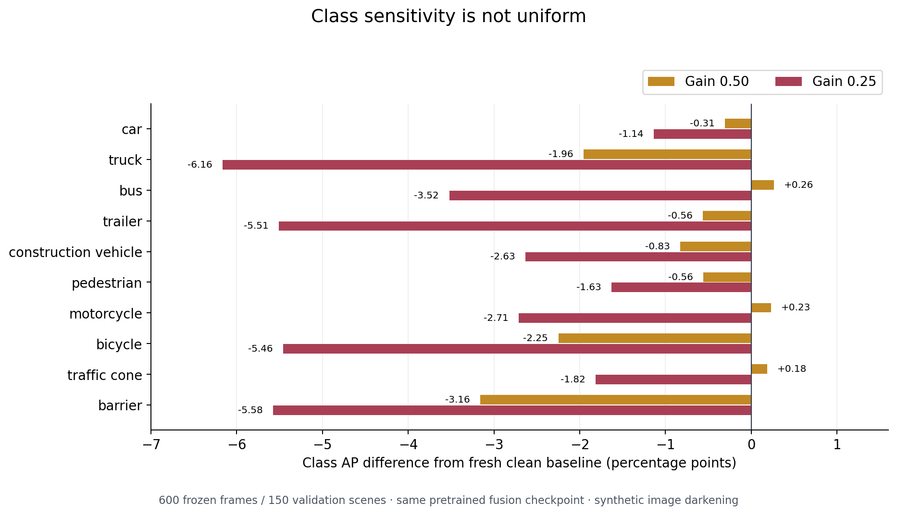
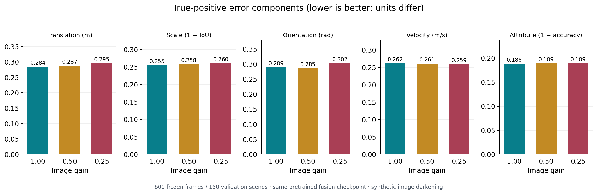

# Image-darkening robustness study — 15 October 2026

A controlled challenge to the official pretrained camera–LiDAR BEVFusion checkpoint on **600 frozen frames from all 150 nuScenes validation scenes**. Four frames were selected per scene before prediction. The same selection was used in the earlier camera-availability study, but the clean baseline here was generated afresh.

## Results

| Image-value gain | mAP ×100 | NDS ×100 | mAP change (points) | NDS change (points) |
|---|---:|---:|---:|---:|
| 1.00 — fresh clean | 68.1300 | 71.2886 | 0 | 0 |
| 0.50 | 67.2352 | 70.8179 | −0.8948 | −0.4707 |
| 0.25 | 64.5150 | 69.1982 | −3.6150 | −2.0904 |

[Interpretation and limitations](FINDINGS.md) · [Headline CSV](tables/headline_metrics.csv) · [Class AP CSV](tables/class_ap.csv) · [TP errors CSV](tables/tp_errors.csv)

## Figures







Each figure is available as PNG, PDF and SVG in [figures](figures/). The class AP is the mean over the four official center-distance thresholds; error panels use different units.

## Evidence and reproduction

- [Frozen protocol](original_evidence/protocol.json), [sample tokens](original_evidence/sample_tokens.txt) and [selection audit](original_evidence/selection_audit.json).
- [Sensor restoration audit](original_evidence/sensor_restoration_audit.json) and [ground-truth metadata audit](original_evidence/evaluation_metadata_audit.json).
- [Successful smoke check](original_evidence/smoke_v3/smoke_audit.json); the earlier failed scripts/logs remain under `smoke/` and `smoke_v2/` for traceability.
- [Inference script](original_evidence/inference/inference.py), per-condition configs/protocols/audits and [inference report](original_evidence/inference/three_condition_inference.json).
- [Evaluation script](original_evidence/evaluation/evaluate_darkening600.py), per-condition summary/detail files, official PR/TP curves and [evaluation report](original_evidence/evaluation/three_condition_evaluation.json).
- [Archive receipt](archive_receipt.json), [import audit](import_audit.json), [original member manifest](original_evidence/evidence_manifest.json) and [generated figure/table manifest](figure_manifest.json).

Recreate derived tables and figures from the repository root:

```bash
python scripts/plot_image_darkening_results.py
```

The plotting script verifies compact-member hashes, summary hashes, headline/class-AP arithmetic, NDS arithmetic and reported differences. It does not rerun inference or ground-truth evaluation. Raw predictions and sensor backups remain separately on Google Drive; the compact archive is 2,491,849 bytes with SHA-256 `0d0a5ddd05185e856b9704df84c2a109af9e8cf6a16a44f2a99ad7b2aa9dd6b3`.

## Scope

This is synthetic multiplication of encoded image values before normalization, not a physical illumination model or real-night benchmark. No model training, camera-only comparison, multi-LiDAR comparison, confidence interval, hardware-cost result or controlled timing measurement is supplied by this experiment.
