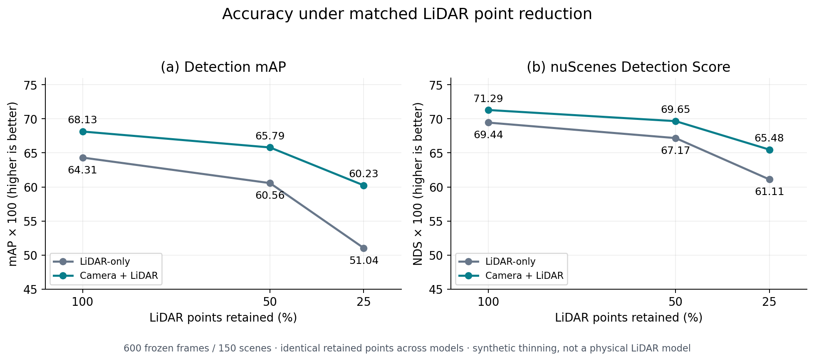
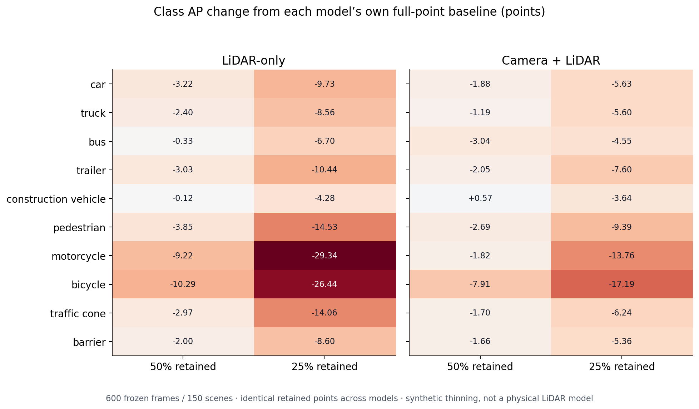

# Matched LiDAR point reduction — 15 October 2026

Six conditions on the same **600 frozen frames / 150 nuScenes validation scenes**: separate pretrained LiDAR-only and camera–LiDAR checkpoints, each at 100%, 50% and 25% retention. Fresh full-point baselines were generated for this experiment.

## Compact main-report figure



One figure contains (a) mAP and (b) NDS versus retention. Lines connect the three measured settings as visual guides, not a fitted response model. PNG, PDF and SVG versions are available in [figures](figures/).

| Retained points | LiDAR mAP ×100 | Fusion mAP ×100 | LiDAR NDS ×100 | Fusion NDS ×100 |
|---|---:|---:|---:|---:|
| 100% | 64.3076 | 68.1302 | 69.4430 | 71.2891 |
| 50% | 60.5637 | 65.7931 | 67.1687 | 69.6546 |
| 25% | 51.0381 | 60.2341 | 61.1077 | 65.4790 |

[Findings and limits](FINDINGS.md) · [Headline CSV](tables/headline_metrics.csv) · [Class AP CSV](tables/class_ap.csv) · [Fusion differences](tables/fusion_advantage.csv) · [Point-count summaries](tables/point_counts.csv)

## Supporting figure



This class-level comparison can be used in an appendix or supplementary repository. Each model is compared with its own full-point baseline. Exact values are annotated; both panels share the same colour scale.

## Protocol and evidence

A token-seeded PCG64 permutation chooses nested subsets; selected rows are sorted back into original input order and point features are unchanged. Sampling is over the loaded keyframe plus temporal sweeps, not separate physical LiDAR units. The same original and retained point hashes match between both models at every token/fraction. Images and metadata hashes are unchanged across retention levels within each model. Reducing points affects both fusion LiDAR features and its camera-depth construction.

- [Frozen protocol](original_evidence/protocol.json), [selection](original_evidence/selection_audit.json), [tokens](original_evidence/sample_tokens.txt).
- [Six-condition smoke audit](original_evidence/smoke/smoke_audit.json), code, predictions and resolved configs.
- [Inference source](original_evidence/inference/inference.py), [six-condition report](original_evidence/inference/six_condition_inference.json), per-condition input ledgers, protocols and configs.
- [Evaluation source](original_evidence/evaluation/evaluate_point_reduction600.py), [evaluation report](original_evidence/evaluation/six_condition_evaluation.json), summaries, details and official curves.
- [Resume checkpoint](original_evidence/resume_checkpoint.json), [archive receipt](archive_receipt.json), [import audit](import_audit.json), [original member manifest](original_evidence/evidence_manifest.json), [figure/table manifest](figure_manifest.json).

All **218 original ZIP members** are preserved. Raw predictions and sensors are separately stored on Drive. Archive: `lidar_point_reduction600_evidence_20261015.zip`, 4,498,505 bytes; SHA-256 `d5086b07200dd4a47668ca95e488129d0d605ce77d8f82fec9fad3a62ad51728`.

Regenerate derived outputs from the repository root:

```bash
python scripts/plot_point_reduction_results.py
```

The script checks compact-member hashes, stored metric arithmetic, pairings of per-frame records and the deterministic index-selection hashes for all 600 frames. It does not rehash raw sensor tensors/predictions or rerun GT evaluation. No statistical significance, real sensor replacement, multi-LiDAR, runtime or monetary-cost result is claimed.
