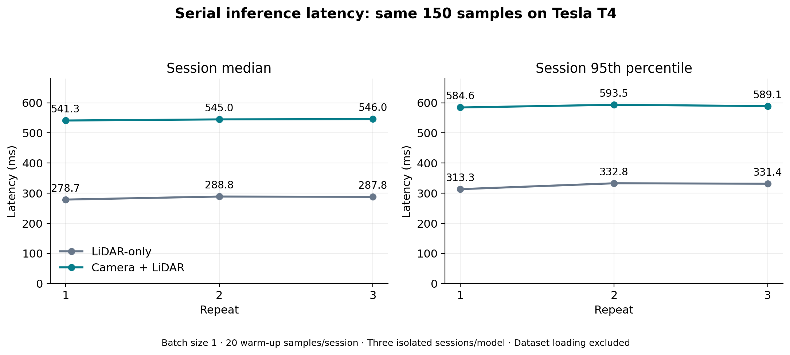
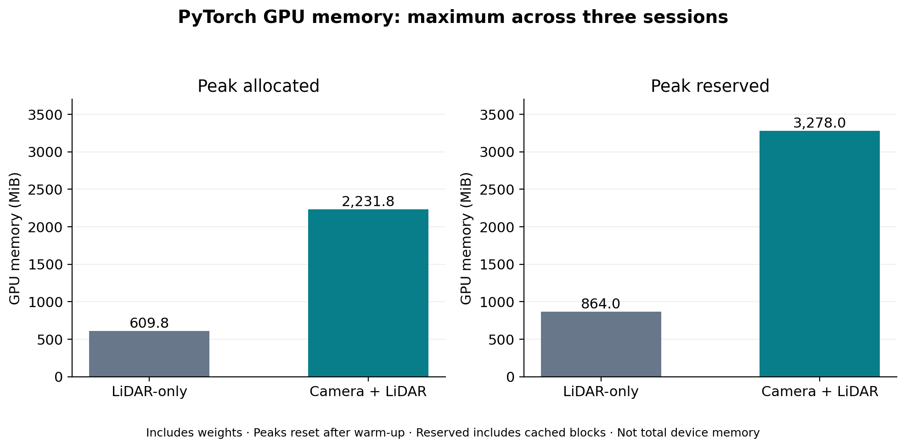

# BEVFusion runtime and GPU memory — 15 October 2026

Same 150 samples (one frame per official validation scene), three isolated sessions per model on a Tesla T4. Each session discards 20 warm-up iterations and measures a full 150-frame pass. Batch size is 1; FP32 weights, autocast disabled and TF32 disabled. Separate official pretrained LiDAR-only and camera–LiDAR checkpoints are compared.

| Model | Median of session medians (ms) | Session median range (ms) | Maximum peak allocated (MiB) | Maximum peak reserved (MiB) |
|---|---:|---:|---:|---:|
| LiDAR-only | 287.81 | 278.69–288.81 | 609.82 | 864.00 |
| Camera + LiDAR | 544.98 | 541.26–545.99 | 2,231.80 | 3,278.00 |

Fusion / LiDAR ratios: **1.8935×** for the median-of-session-medians latency and **3.6598×** for maximum allocated memory. These describe the tested implementation and cloud runtime, not universal hardware requirements.





## Figures, tables and original evidence

- [Findings and timing limitations](FINDINGS.md), [exact analysis summary](analysis_summary.json).
- [Accuracy versus latency](figures/accuracy_latency.png): accuracy uses 600 frames; runtime uses a nested 150-frame subset. These are separately measured scopes.
- [All PNG/PDF/SVG figures](figures/), [comparison matrix](tables/accuracy_compute_matrix.csv), [session summaries](tables/session_summary.csv), [paired per-sample timing](tables/paired_latency.csv).
- [Frozen runtime protocol](original_evidence/protocol.json), [tokens](original_evidence/sample_tokens.txt), [benchmark code](original_evidence/benchmark_session.py), [all six session records](original_evidence/sessions/).
- [Setup and GPU-operation checks](original_evidence/setup/), [restoration audit](original_evidence/sensor_restoration_audit.json), [accuracy context](accuracy_context/).
- [Archive member manifest](evidence_manifest.json), [import verification](import_audit.json), [generated-figure manifest](figure_manifest.json).
- [Architecture diagrams](../../../../../docs/architecture/README.md), [cost-analysis framework and initial sources](../../../../cost_performance/README.md).

## Timing boundary

The primary clock starts after CPU dataset loading and pseudo_collate, with CUDA synchronized. It ends after test_step and a second synchronization. The measurement includes host/device transfer, model preprocessing, prediction and its postprocessing. It excludes checkpoint/model initialization, file decoding, CPU dataset transforms, copying predictions to CPU for validity checks, export and accuracy evaluation. Loading/preparation time is measured separately; OS caching applies. Inference outputs are checked but accuracy is not recomputed.

Memory uses PyTorch allocator peaks reset after warm-up, including resident weights. Reserved memory includes cached allocator blocks and is not additional live-tensor memory. These values are not total-device memory from nvidia-smi. No empty_cache is called between measured frames.

## Reproduction

Plot stored results from the repository root:

```bash
python scripts/plot_bevfusion_runtime_results.py
python scripts/draw_perception_architecture.py
```

To rerun the benchmark, restore the exact protocol, verified annotations, sensors and checkpoint files to their recorded Colab paths. Invoke `benchmark_session.py --model lidar --repeat 1` and the remaining model/repeat arguments in the frozen session_order, with a fresh process per session and the saved single-thread environment. Keep timing runs separate from other GPU work. The plotting script verifies raw hashes, token order, per-session statistics and matched point counts before plotting. It does not itself rerun the model.

The dataset, checkpoints and annotation pickle remain on Drive; the compact repository evidence does not contain them.
