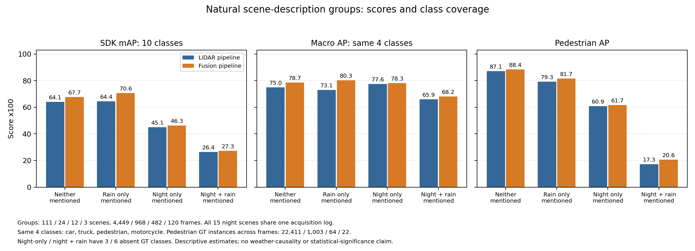

# Completed CPU natural-weather group analysis

The real CPU run is complete. Both full-split replays pass before subgroup evaluation. The uploaded evidence ZIP matches the reported Drive-copy SHA-256, and every one of its 69 manifest-listed payloads passes local size/hash checks. [Import and arithmetic verification](import_verification.json).

## Findings

Fusion-minus-LiDAR ten-class mAP gains are +3.57 / +6.26 / +1.23 / +0.93 points for neither-mentioned / rain-only / night-only / night-and-rain strata. Class coverage differs: 10 / 10 / 7 / 4 GT-represented classes. All 15 night scenes share one acquisition log; group scores do not isolate weather causality.

On the same four classes (car, truck, pedestrian, motorcycle), AP x100 is 74.98/78.67, 73.08/80.30, 77.56/78.26 and 65.89/68.21 for LiDAR/fusion. This is a labelled sensitivity summary, not official ten-class mAP. Night/rain pedestrian AP is 17.28/20.59 over 22 GT instances across frames, not 22 independent people/environments. Aggregate improvements coexist with three represented-class regressions; see the [report discussion](../../../../../../docs/report/NATURAL_WEATHER_GROUPS_2026-10-28.md).

## Files

- [Exact group metrics](group_metrics.csv), [class metrics and GT counts](class_metrics.csv), [paired summary](paired_summary.json).
- [LiDAR full replay check](lidar/full_replay_check.json) and [fusion full replay check](lidar_camera/full_replay_check.json): 32,451 numeric values each, maximum error 8.881784197001252e-16, tolerance 1e-12.
- [Coverage-aware figure PDF](weather_coverage_comparison.pdf); the PNG above is also derived from unchanged source metrics.
- [Original payload manifest](evidence_manifest.json), [metadata derivation](evaluation_metadata_derivation.json), [description review](description_review.json).
- [Complete unchanged source evidence ZIP](weather_group_evaluation_20261028T214858551297Z.zip): 2,156,223 bytes, SHA-256 `75126afda2354f95f9402fccfa37100fb45d3f956cb1d5600cfb6fdf2c289227`. Contains every original payload including full/group metric summaries and PR arrays, executed code, reference metrics, environment and execution logs, frozen preparation and original figure. Bulk predictions and raw sensor/GT files are excluded.

## Rebuild and scope

Run `python ../summarise_completed_weather_groups.py PATH_TO_SOURCE_ZIP --output NEW_OUTPUT_DIRECTORY`. This checks the exact archive, reconciles saved replay metrics, recomputes AP arithmetic from PR curves, verifies GT partitions and creates the coverage-aware figure. It does not run inference or evaluate ground truth. Local figure layout has been visually reviewed.

The newly generated figure and report are preserved on GitHub; the Colab Drive receipt covers the original source ZIP and original figure, not these later local additions. Fog is the next separate bounded experiment. No fog/snow result is claimed here.
