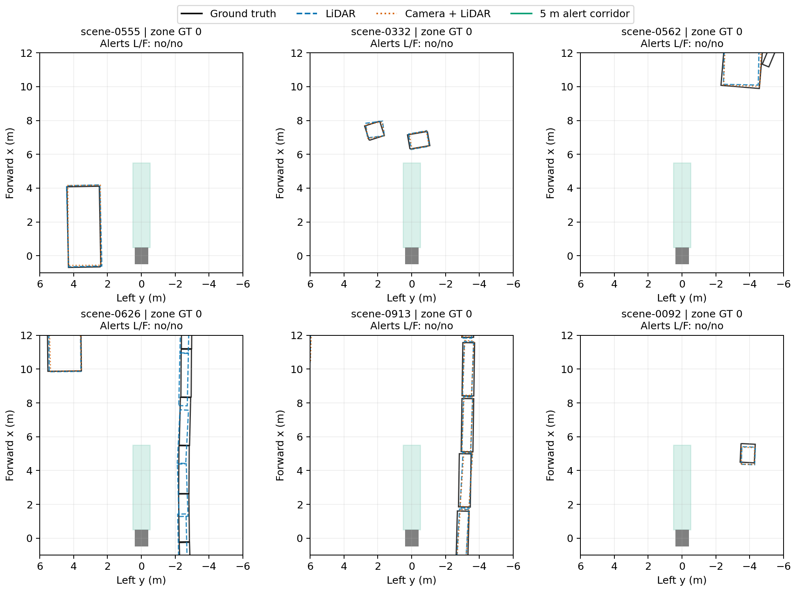

# Camera–LiDAR perception for a hypothetical mobile robot

This CPU-only study connects the project's actual saved nuScenes detections to a spatial obstacle-alert rule. It uses no robotic-arm simulation, new detector inference, physical robot or factory data. The result is a bounded integration demonstration, not a robot safety or deployment claim.

## Main finding

The six previously selected diagnostic frames are insufficient for a useful comparison of near-field obstacle alerts. At the primary 5 m forward length and score threshold 0.30, neither model raises an alert and no SDK-filtered ground-truth box intersects the corridor. At the predeclared 10 m length, scene-0332 contains one intersecting annotated object; both models detect it and raise an alert at all three thresholds. The other five frames contain no intersecting annotated object. The 2 m condition contains none. These findings provide no evidence of a fusion advantage or disadvantage for this alert task.

| Forward length from robot front | Frames with intersecting GT / 6 | LiDAR alerts / 6 | Fusion alerts / 6 |
|---|---:|---:|---:|
| 2 m | 0 | 0 | 0 |
| 5 m (primary) | 0 | 0 | 0 |
| 10 m | 1 | 1 | 1 |

Counts above are identical at score thresholds 0.10, 0.30 and 0.50. They are descriptive counts on six outcome-selected frames, not estimates of robot reliability. The 108 CSV rows are repeated settings on these same six frames, not 108 independent observations. A lack of annotated boxes is not a verified free-space label.

## Method

The protocol was written before computing corridor outcomes. It fixes a hypothetical 1.0 m long, 0.8 m wide robot centred at the recorded ego origin, with a 0.1 m lateral margin on each side. Its forward rectangle starts at x=0.5 m (the assumed robot front); primary extent is x=0.5–5.5 m, y=-0.5–0.5 m. The longer sensitivity rectangle ends at x=10.5 m. These dimensions are assumptions, not vehicle measurements or stopping distances.

The original archive is verified against SHA-256 `574a5ea93c4fc455317562caaa82a30f25ce3f8b20715ddbf2e05c0cff0b9bdd`. LIDAR_TOP filenames identify each keyframe's recorded ego pose. All eight box corners are transformed from global coordinates using the full ego quaternion; the convex hull of their XY projection is tested against the corridor by the separating-axis theorem. Box size follows nuScenes width/length/height order. Boundary contact counts as intersection. There is no height filter, motion prediction, tracking or traversability model.

Any eligible intersecting predicted box triggers an alert, irrespective of class. The GT reference uses already SDK-filtered boxes in the archive, so class exclusions, range filters and point-count filters remain. Object diagnostics separately reproduce the earlier same-class, descending-score greedy match at strictly less than 2 m global XY centre distance; coverage additionally requires the assigned predicted footprint to intersect the corridor. This matching convention is a detection diagnostic, not a collision criterion.

Checks cover identity-preserving global/ego roundtrips below 1e-9 m, a known 90-degree rotation, polygon containment/touch/disjoint fixtures, exact reproduction of saved 0.30 matching, and the original input hash. They establish computational consistency, not exhaustive geometric or real-world validation.

## Figure



**Figure caption:** Static nuScenes six-case replay in the recorded keyframe ego frame. Black outlines are filtered ground truth, dashed blue LiDAR-only predictions, and dotted orange camera–LiDAR predictions at score >=0.30. Green shading marks the hypothetical 5 m forward alert corridor; the grey rectangle is the assumed robot footprint. All six primary corridors contain no filtered annotated object, so this selection cannot establish comparative obstacle-alert performance. The plot shows a local crop; intersection tests use full geometry. Units are metres. Existing GPU predictions are reused; the geometry analysis runs on CPU.

## Reproduce

Use Python 3.12 with `requirements.txt`, and obtain the preserved original `nuscenes_six_case_annotation_inputs.zip` separately. Dataset images and raw sensor data are not redistributed here.

```bash
python run_study.py --inputs /path/to/nuscenes_six_case_annotation_inputs.zip --output results
```

`all_conditions.csv` contains every setting; `primary_results.json` contains the 12 primary model/frame records; `ego_footprints.json` preserves derived polygons in the original GT/prediction order; `pose_records.json` identifies the poses. `audit.json` records protocol, code and input hashes. Figures regenerate from those same inputs.

## What this adds to the dissertation

The implementation establishes an explicit interface between 3D perception and a mobile-robot spatial decision. It also demonstrates why detector-level improvements cannot automatically be claimed as navigation improvements: more detections elsewhere in a scene may not alter a forward corridor alert. This is a methodological result, not proof that fusion has no robotics benefit.

A useful next evaluation would apply this frozen geometry to a broader, independently defined sample such as the existing frozen 600 frames, using saved predictions and metadata. It should report how many frames actually contain annotated corridor obstacles, missed alerts and unreferenced alerts, with scene-level uncertainty if supported. If obstacle-positive coverage remains inadequate, a separately declared dataset/trajectory design is required. Do not widen the corridor or select headings after seeing model outcomes to manufacture a favourable comparison.

Factory deployment remains future work: factory-specific classes and data, appropriate sensor placement, coordinate/time synchronisation, unclassified-obstacle sensing, tracking, planning and independently validated stopping/control behaviour would all need evaluation. A nuScenes checkpoint is not thereby shown to detect pallets, low shelving, cables or factory machinery.

Coordinate convention reference: [ROS REP-103](https://reps.openrobotics.org/rep-0103/), checked 23 October 2026: body x forward, y left, z up. This script is not a ROS/Nav2 integration and publishes no control commands.
