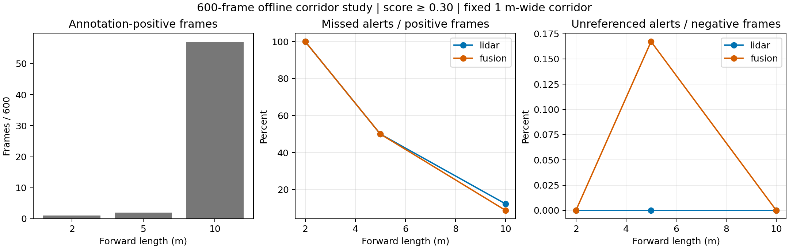

# Camera–LiDAR mobile-robot corridor analysis: 600 frames

## Result and interpretation

This completed CPU analysis connects saved LiDAR-only and camera–LiDAR detections to a fixed hypothetical mobile-robot alert rule. It uses all 600 frozen frames from 150 nuScenes scenes. It does not run a robot, motion planner or new neural-network inference.

At the primary 5 m corridor and confidence threshold 0.30, just two frames are annotation-positive. Both models alert on one and miss the other. Fusion additionally raises one alert in an annotation-negative frame. This primary result is too sparse to establish comparative reliability.

The predeclared 10 m sensitivity setting has 57 annotation-positive frames across 29 scenes. LiDAR misses seven and fusion misses five. Fusion recovers three alerts that LiDAR misses and loses one alert that LiDAR supplies: a net difference of two, not a uniform improvement. The paired scene-bootstrap 95% interval for fusion-minus-LiDAR missed-alert rate is −11.11 to +3.57 percentage points, including zero. A reliable superiority claim is not supported.

| Forward length | Positive / negative frames | LiDAR missed / positive | Fusion missed / positive | LiDAR unreferenced / negative | Fusion unreferenced / negative |
|---|---|---|---|---|---|
| 2 m | 1 / 599 | 1 / 1 | 1 / 1 | 0 / 599 | 0 / 599 |
| **5 m primary** | **2 / 598** | **1 / 2** | **1 / 2** | **0 / 598** | **1 / 598** |
| 10 m sensitivity | 57 / 543 | 7 / 57 (12.28%) | 5 / 57 (8.77%) | 0 / 543 | 0 / 543 |

All table rows use score ≥0.30 and the same 600 frames. `summary.csv` also records thresholds 0.10 and 0.50. These are frame-level binary alerts, not object-level recall, AP, NDS or measured collision avoidance. A correct frame alert can originate from a different predicted object than the annotated object; this analysis does not establish correct object association.

## Frozen protocol and data

The geometry follows the preceding six-case pilot: hypothetical footprint 1.0 ×0.8 m, centred at recorded ego origin; margin 0.1 m per side; corridor width 1.0 m. Corridors start at the assumed robot front x=0.5 m and extend by 2, 5 or 10 m. Thus the primary corridor is x∈[0.5,5.5], y∈[−0.5,0.5]. These are illustrative dimensions, not measured stopping distances. Geometry and thresholds were not adjusted after inspecting outcomes. The 600-frame annotation-policy addendum was frozen before computing its outcomes.

Input ZIP SHA-256: `6565e5002bb8fad8d812ad88b30711e42db899ac5fa90b23e173c3fb9d44df56`. All four internal files match their preserved hashes. Annotation order equals the frozen token order, prediction token sets match exactly, and the preserved scene selection maps four unique frames to each of 150 scenes. The original six cases are not pooled into these results.

### Ground-truth limitations

The supplied MMDetection3D annotation file stores LiDAR-frame box centre, length, width, height and yaw, plus sensor-to-ego and ego-to-global matrices. The pinned converter uses box centres (not bottom centres), swaps SDK width/length into length/width/height and stores yaw; the v2 conversion copies those box values. The script follows this convention and transforms the eight reconstructed corners to ego coordinates.

The stored yaw cannot recover the original full quaternion orientation. Consequently this is **annotation-based analysis**, not exact full-orientation SDK ground-truth replay. Known detection classes are retained only when LiDAR+radar point count is positive and the ego-frame centre is within the standard class range: 50 m for vehicles, 40 m for pedestrian/bicycle/motorcycle and 30 m for barrier/cone. The corresponding range rule also applies to predictions. The annotation file lacks bike-rack metadata, so bike-rack exclusion is not applied to either side. No claim of exact official filtering parity is made. The retained class counts are recorded in `audit.json` (12,319 total boxes).

An annotation-negative corridor is not certified free space: excluded classes, unlabelled obstacles and filtering can all matter. Therefore alerts without an intersecting reference box are called **unreferenced alerts**, not proven physical false alarms. Static box footprints ignore height clearance, object velocity, road topology, braking and tracking. Only supported detection classes are represented; factory pallets, cables, shelving and machinery are not validated by this road dataset.

## Geometry and checks

Predicted SDK-format global boxes use full quaternion orientation and width/length/height. Global corners are transformed with the inverse recorded ego2global matrix. GT corners use the stored yaw and lidar2ego matrix. The convex hull of all eight projected XY corners is tested by the separating-axis theorem; touching counts as intersection. No height filter is imposed.

Checks passed: uploaded and internal hashes; 600 unique paired tokens; 150 scenes × four frames; valid transformation bottom rows; rotation orthogonality below 1e-5; known 90-degree rotation; polygon containment, disjointness and boundary-touch fixtures. Maximum observed rotation orthogonality error was 8.123e−8; prediction-centre global/ego roundtrip error was 1.365e−12 m. These checks establish numerical consistency, not external robot validation.

## Uncertainty and dependence

The analysis uses 2,000 paired bootstrap resamples of 150 scenes with replacement, seed 20261023. Each sampled scene retains its four frames and both models. Percentile intervals measure scene-sampling variation conditional on the selected frames, annotations and checkpoints; they omit training, sensor, annotation and deployment uncertainty.

At 5 m, only 1,743/2,000 resamples contain any annotation-positive frame. Undefined missed-alert ratios are excluded and their count is recorded. Both models have identical primary misses, so the paired-difference interval degenerates to zero; this is not evidence of real-world equivalence. Each model's missed-alert interval spans 0–100%. Similarly, zero observed unreferenced alerts can produce a degenerate bootstrap interval and does not establish a zero population rate. At 10 m all 2,000 resamples have a defined missed-alert rate.

## Critical cases

At 10 m and threshold 0.30, fusion alone alerts in scene-0916 (`a19a80c905674faab7203a3a4e0f5246`), scene-0553 (`a572dd2e95e94e4db66bb5dbfaf870b5`) and scene-0563 (`3954febdb9e84232a17173654dd728a4`). LiDAR alone alerts in scene-0969 (`68eec73ac1ac49c9917640b8ee867b66`). These are post-result diagnostic cases, not newly selected headline evaluation frames. Scene-0563 also has the fusion-only unreferenced alert at 5 m; the longer corridor changes its annotation-positive status. Images and object-level attribution have not been inspected for these cases, so causes remain unconfirmed.

## Compact report figure



**Caption:** Offline annotation-based alert analysis on 600 frozen nuScenes frames from 150 scenes, confidence ≥0.30, 1 m-wide corridor. Left: number of annotation-positive frames. Centre: missed alerts divided by annotation-positive frames. Right: unreferenced alerts divided by annotation-negative frames. The primary 5 m result contains only two positive frames; the 10 m sensitivity result has 57. Lines connect discrete tested settings and do not establish intermediate behaviour. The plot shows point estimates; paired scene-bootstrap intervals are in `scene_bootstrap.csv` and described above. Existing T4 predictions are reused; this analysis runs on CPU. The study establishes an offline perception-to-alert interface, not physical robot safety or factory performance.

## Reproduction and preservation

Use Python 3.12 and the versions in `requirements.txt`. Obtain the hash-verified input ZIP separately; raw predictions and annotations remain outside Git.

```bash
python run_analysis.py --inputs /path/to/mobile_robot600_inputs.zip --output results
```

`frame_results.csv` records 10,800 rows (600×3 lengths×3 thresholds×2 models), not independent observations. `summary.csv`, `scene_bootstrap.csv`, `primary_results.json`, `primary_alert_indices.json`, the composite PNG/PDF and `audit.json` are generated from those inputs. `scene_selection.json` preserves the original scene grouping; `protocol.json` fixes assumptions. Do not combine this analysis numerically with official mAP/NDS or the differently filtered six-case pilot.

## Dissertation contribution

The contribution is the reproducible connection of benchmark perception to a task-specific spatial decision and the critical evaluation of its limits. Higher aggregate detection accuracy does not automatically guarantee improved near-field alerts. Here the primary test is underpowered by obstacle scarcity, while the longer predeclared corridor shows a small, uncertain improvement with both gains and regressions. A stronger robotics evaluation would require independently specified obstacle-rich trajectories and suitable robot-domain annotations; no further geometry tuning on these outcomes is justified as confirmatory evidence.

Sources for conventions, inspected 23 October 2026:
- [Pinned nuScenes converter](https://github.com/open-mmlab/mmdetection3d/blob/fe25f7a51d36e3702f961e198894580d83c4387b/tools/dataset_converters/nuscenes_converter.py).
- [Pinned v2 annotation conversion](https://github.com/open-mmlab/mmdetection3d/blob/fe25f7a51d36e3702f961e198894580d83c4387b/tools/dataset_converters/update_infos_to_v2.py).
- [ROS REP-103 coordinate conventions](https://reps.openrobotics.org/rep-0103/). No ROS runtime integration is claimed.
