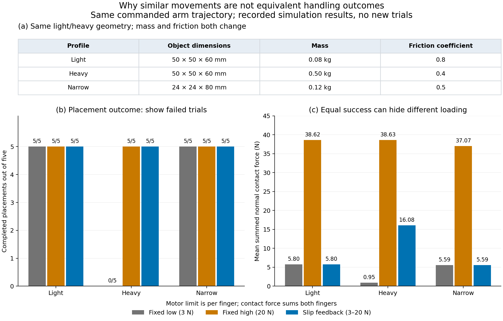

# Supervisor follow-up: illumination, rain and robotic-arm clarification

## Completion status

The synthesis of the completed case studies and the robotic-arm explanation is now prepared. No additional inference or simulation was needed. The evidence supports critical discussion under selected recorded conditions; it does not constitute comprehensive common-weather validation.

| Supervisor request | Completed evidence | Limit that must accompany it |
|---|---|---|
| Different illumination | Controlled 600-frame darkening study, A–D follow-up and two original night frames plus the added annotated night/rain pedestrian | Darkening is synthetic; the two night frames are illustrative |
| Atmospheric conditions / common weather | Rain-labelled bus success, barrier regression and combined night/rain frame | No isolated rain effect, measured intensity or representative weather-specific accuracy |
| Clear single-case comparisons | Individual A–D figures plus paired rain/night composites | Camera crops show selected views; full-frame counts cover all directions |
| Failures, limitations and challenges | Ten-class threshold counts, box errors, visibility and point support | Diagnoses score/matching outcomes; network failure causes remain unproven |
| Similar light/heavy arm results | New clarification figure and revised report explanation | Same shape/motion; mass and friction both change; simulator-state feedback |

## Main findings for the meeting

1. **Fusion can help or regress.** At score 0.30, the selected truck is a fusion-only match, the selected car a LiDAR-only match, the bus a shared match and the cone a shared miss.
2. **A threshold crossing does not improve every box measure.** For B, half brightness raises fusion score 0.286743 → 0.316402 but raises centre error 0.095702 → 0.179738 m. Frame TP rises 14 → 15 with FP count three; LiDAR remains at 21 TP.
3. **A retained target can hide frame-wide degradation.** C's bus remains matched, while quarter brightness reduces fusion TP 72 → 56 and raises FN 7 → 23.
4. **Rain/night examples require annotation-aware interpretation.** Rain-labelled scenes include both shared success and regression. The night frame has two matched/two missed cars per model at 0.30; the night/rain frame has no eligible ten-class GT and cannot supply positive pedestrian recall evidence.
5. **The arm plots show different questions.** Identical geometry and commanded motion explain similar appearances and successful paths. For the heavy profile, high fixed grip and feedback both place 5/5, but mean simulated contact loads are 38.63 and 16.08 N. Low fixed grip places 0/5.

The [report discussion](../../../docs/report/ILLUMINATION_WEATHER_DISCUSSION_2026-10-28.md) gives the detailed argument and exact source links. The [revised arm section](../../../docs/report/ROBOT_ARM_PILOT_2026-10-22.md) addresses the separate manipulation question.

## Figures and compact evidence

- [A–D comparison](../../nuscenes/bevfusion/case_analysis/20261028/results/four_case_darkening_composite.png).
- [Rain comparison](../../nuscenes/bevfusion/case_analysis/20261028/extension/results/real_rain_case_comparison.png).
- [Night comparison](../../nuscenes/bevfusion/case_analysis/20261028/night_cases/results/night_case_comparison.png).
- [Consolidated A–D evidence CSV](case_evidence.csv): exact target scores/errors alongside ten-class frame counts at 0.30.
- [Arithmetic and record checks](verification.json): 48 A–D threshold rows, 12 night threshold rows, and all 45 arm trial records reaggregated against nine saved groups. These checks do not rerun inference, official evaluation, raw matching or physics.



**Caption.** Preserved 45-trial Panda simulation: profile parameters, completed placements and mean summed finger-object normal contact force. Each group contains five paired initial offsets. Light/heavy objects have identical dimensions but differ in both mass and friction. All policies share commanded arm waypoints. The zero-success heavy/low condition is labelled explicitly; its low contact loading is not favourable performance. Loads include failed trials. Per-finger motor limits differ from measured forces summed across both fingers. Feedback uses ideal simulator relative-height observations; no detector input, physical contact sensing, damage model or mass-only causal comparison is demonstrated. The figure is regenerated from recorded tables, without new trials. [PDF](arm_feedback_clarification.pdf) · [SVG](arm_feedback_clarification.svg).

## Reproduction and preservation

From the repository root, using NumPy and Matplotlib:

```bash
python scripts/build_supervisor_followup.py
```

This checks the preserved tables and regenerates the CSV, arm clarification figure and verification record. Existing original evidence remains the numerical source. The case-analysis manifest's README entry is updated to reflect its current documentation; original numerical entries remain unchanged.

The CPU preservation utility `scripts/preserve_supervisor_followup.py` downloads the selected public repository files at an explicit commit, verifies Git blob identities, packages them with SHA-256 hashes and verifies a destination copy. See [preservation instructions](../../../docs/report/FOLLOWUP_PRESERVATION_2026-10-28.md). **Execution against the user's mounted Drive remains pending.** It cannot be completed or claimed from GitHub access alone.

## Key takeaway

The bounded discussion and arm clarification are complete. The next submission work is chapter integration, literature synthesis and poster preparation. The [additional annotation-positive night/rain pedestrian case](../../nuscenes/bevfusion/case_analysis/20261028/night_rain_pedestrian/README.md) is complete: both models miss the target at all three predeclared thresholds. Broader representative weather evaluation remains future work. The [nine-case coverage map](../../../docs/report/CASE_COVERAGE_AND_STRUCTURE_2026-10-28.md) shows how every selected frame can contribute to the dissertation.

## Final bounded case addition

Scene-1067 supplies one eligible pedestrian at 30.06 m with one current-scan LiDAR point and visibility 80–100%. Nearby candidate scores are 0.029148 (LiDAR) and 0.008018 (fusion); both miss at 0.10, 0.30 and 0.50. At 0.30 each pipeline matches the same four of seven frame GT objects, with zero FPs. The paired figure, exact tables and discussion are complete. Input preservation is verified; the later derived-output Drive copy remains separate. This is a labelled positive frame, not detection success or proof of weather causality.
